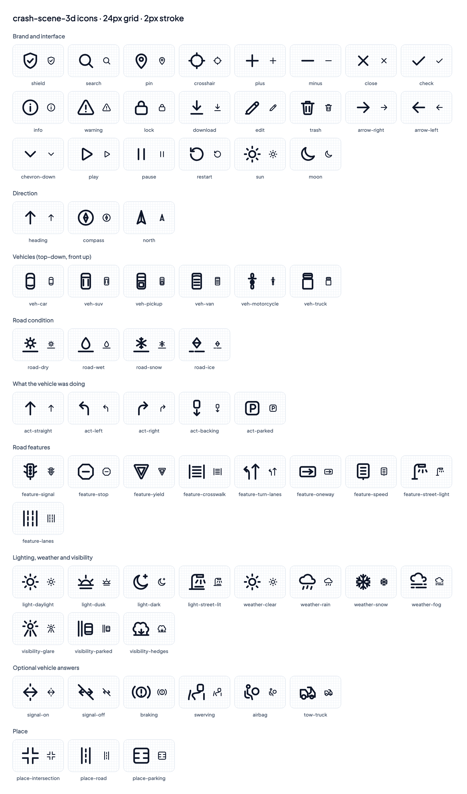

# DESIGN.md — crash-scene-3d

> **Status: locked 2026-10-09** (commit after 45ea0f6). Changes from here go through Zoheb.

The design contract for the crash-scene tool that ships inside InsurifyAI. The UI implements this document and the design frames exactly. Every color, size, radius, shadow, duration and layer in the code comes from a token in section 2, used as a CSS variable. Component styles contain no raw hex, rgb, pixel font sizes or magic numbers.

- **Brand source:** the public site https://insurifyai.app, app theme, read 2026-10-09. Values were observed; no code was copied.
- **Theme:** InsurifyAI app theme, light by default, dark supported.
- **Design files:** section 12.

---

## 1. Principles

1. **Plain words, few steps.** A stressed driver on a phone finishes in about two minutes.
2. **An illustration, never evidence.** The disclaimer is visible on every screen and in every export. Nothing sounds like a legal finding, a fault decision or an expert opinion.
3. **Looks like InsurifyAI.** Same blue, same slate surfaces, same rounded white cards, same voice.
4. **Color is never the only cue.** Vehicles carry a letter (A–D) and a name as well as a color.
5. **Phone first.** Every screen is designed at 390 px, then widened.
6. **Private by default.** Exports are made in the browser and saved to the device. Nothing is uploaded. Only what's needed to draw the map leaves the browser, and only through our own proxy (section 9): the typed address text, the pin rounded to about 1 m for the roads around it, and the map and terrain tiles in view.

---

## 2. Design tokens

The canonical file is `design/tokens.css`. At scaffold time it moves to `src/styles/tokens.css` unchanged. The block below is that file, verbatim; `npm run check:tokens` in `design/prototype` fails if they differ.

- **Light and dark:** each color uses `light-dark()`. The host app sets `class="dark"` or `class="light"` on `<html>`; otherwise the OS setting decides.
- **3D scene colors:** Three.js cannot read CSS variables. One helper resolves each `--color-scene-*` and `--color-vehicle-*` token by applying it to a hidden probe element and reading the computed color. It runs at startup and on theme change. Scene code has no color literals.
- **Contrast:** every text/background pair is at least 4.5:1, or 3:1 for text 24 px and up, bold 19 px and up, icons and focus rings. Ratios are noted beside the tokens. `*-fill` status tokens are never used for text.
- **Logo blue:** `--color-logo` (#2369D7) is the official InsurifyAI logo blue. It is identical in light and dark and is never theme-shifted; it is not the UI brand blue (`--color-brand`). It is the only color of the logo mark and of the "AI" in the wordmark. Contrast: 5.2:1 on the light surface, 3.5:1 on the dark surface (3:1 needed for a graphic and for large bold text). `--logo-mark-height` and `--logo-gap` hold the lockup proportions (section 13).
- **Fonts:** Plus Jakarta Sans and JetBrains Mono, self-hosted in the app (for example via Fontsource) so no font request goes to a third party. The prototype loads them from Google Fonts for convenience.

```css
/* crash-scene-3d design tokens — the single source of truth.
   DESIGN.md section 2 embeds this file verbatim; `npm run check:tokens` in
   design/prototype fails if they drift. Components use var(--…) only.
   Light/dark: light-dark() follows color-scheme. The host app sets
   class="dark" or class="light" on <html>; otherwise the OS setting wins. */

:root {
  color-scheme: light dark;

  /* ---------- Color: surfaces ---------- */
  --color-bg:                light-dark(#F8FAFC, #020617);
  --color-surface:           light-dark(#FFFFFF, #0F172A);
  --color-surface-2:         light-dark(#F1F5F9, #1E293B);
  --color-surface-3:         light-dark(#E2E8F0, #334155);
  --color-border:            light-dark(#E2E8F0, #1E293B);
  --color-border-strong:     light-dark(#CBD5E1, #334155);
  --color-overlay:           light-dark(rgb(15 23 42 / 0.48), rgb(0 0 0 / 0.64));

  /* ---------- Color: text (contrast on --color-surface, light / dark) ---------- */
  --color-text:              light-dark(#0F172A, #F8FAFC);   /* 17.9 / 17.1 */
  --color-text-secondary:    light-dark(#475569, #94A3B8);   /*  7.6 /  7.0 */
  --color-text-tertiary:     light-dark(#5F6E84, #94A3B8);   /*  5.2 /  7.0 */
  --color-text-on-brand:     light-dark(#FFFFFF, #0F172A);   /*  5.2 /  7.0 on brand */
  --color-text-link:         light-dark(#1D4ED8, #93C5FD);

  /* ---------- Color: brand ---------- */
  --color-brand:             light-dark(#2563EB, #60A5FA);
  --color-brand-hover:       light-dark(#1D4ED8, #93C5FD);
  --color-brand-tint:        light-dark(#EFF6FF, #172554);
  --color-brand-tint-text:   light-dark(#1D4ED8, #BFDBFE);   /*  6.2 on tint */
  --color-focus-ring:        light-dark(#2563EB, #93C5FD);

  /* The official InsurifyAI logo blue (design/brand/). The same in light and dark and
     never theme-shifted: it is the logo, not a UI color. Only the mark and the "AI" of
     the wordmark use it. 5.2 on the light surface / 3.5 on the dark surface (3:1 needed). */
  --color-logo:              #2369D7;
  /* Logo lockup, measured from logo-full.png and relative to the wordmark's font size:
     the mark is 1.742 x the font size tall; the gap to the first letter is 0.343 em. */
  --logo-mark-height:        1.742em;
  --logo-gap:                0.343em;

  /* ---------- Color: status. *-fill = icons, dots, bars only. Never text. ---------- */
  --color-success-fill:      #10B981;
  --color-success-text:      light-dark(#047857, #34D399);   /*  5.5 */
  --color-warning-fill:      #F59E0B;
  --color-warning-text:      light-dark(#B45309, #FCD34D);   /*  5.0 */
  --color-warning-tint:      light-dark(#FEF3C7, #451A03);
  --color-warning-tint-text: light-dark(#92400E, #FDE68A);   /*  6.4 on tint */
  --color-danger-fill:       #EF4444;
  --color-danger-text:       light-dark(#B91C1C, #FCA5A5);   /*  6.5 */

  /* ---------- Color: vehicles. Letter + name always shown too. ---------- */
  --color-vehicle-a:         light-dark(#2563EB, #60A5FA);   /*  5.2 */
  --color-vehicle-b:         light-dark(#C2410C, #FB923C);   /*  5.2 */
  --color-vehicle-c:         light-dark(#0F766E, #2DD4BF);   /*  5.5 */
  --color-vehicle-d:         light-dark(#A21CAF, #E879F9);   /*  6.3 */

  /* ---------- Color: 3D scene, diagram and map ---------- */
  --color-scene-ground:      light-dark(#E2E8F0, #1E293B);
  --color-scene-grass:       light-dark(#DCE7DA, #1A2A22);
  --color-scene-road:        light-dark(#94A3B8, #475569);
  --color-scene-lane:        light-dark(#FFFFFF, #E2E8F0);
  --color-scene-path:        light-dark(#0F172A, #F8FAFC);
  --color-scene-impact:      light-dark(#B91C1C, #F87171);
  --color-scene-measure:     light-dark(#0F172A, #F8FAFC);
  --color-map-pin:           light-dark(#2563EB, #60A5FA);
  --color-map-street:        light-dark(#7C3AED, #8B5CF6);   /* chosen streets drawn on the map, over a white halo */
  --color-map-street-halo:   light-dark(#FFFFFF, #FFFFFF);   /* the OSM tiles stay light in both themes */
  /* The drawn stand-in map (fixtures/test mode: every tile, drawn from road data): OSM-like and light in both themes, like the real tiles */
  --color-map-ground:          light-dark(#F2EFE9, #F2EFE9);
  --color-map-road:            light-dark(#FFFFFF, #FFFFFF);
  --color-map-road-casing:     light-dark(#BBBBBB, #BBBBBB);
  --color-map-road-major:      light-dark(#FCD6A4, #FCD6A4);
  --color-map-road-major-casing: light-dark(#C9A26F, #C9A26F);
  --color-map-building:        light-dark(#D9D0C9, #D9D0C9);
  --color-map-building-edge:   light-dark(#C4B9AE, #C4B9AE);
  --color-map-parking:         light-dark(#EEEEEE, #EEEEEE);
  --color-map-label:           light-dark(#333333, #333333);
  --color-scene-lot:         light-dark(#CBD5E1, #334155);   /* parking-lot surface */
  --color-scene-debris-glass:   light-dark(#E0F2FE, #BAE6FD);   /* glass shards on the road after the hit */
  --color-scene-debris-plastic: light-dark(#475569, #CBD5E1);   /* plastic and trim fragments */
  --color-scene-skid:        light-dark(#0F172A, #020617);   /* tire marks, drawn translucent */
  --color-scene-label:       light-dark(#1E293B, #E2E8F0);   /* street names painted on the road: 7.9:1 on road */
  --color-scene-glass:       light-dark(#475569, #1E293B);   /* vehicle windows */
  --color-scene-tire:        light-dark(#0F172A, #020617);   /* vehicle tires */
  --color-scene-headlight:   light-dark(#FDE68A, #FEF3C7);   /* vehicle headlights */
  --color-scene-taillight:   light-dark(#DC2626, #EF4444);   /* vehicle taillights */
  --color-scene-sky:         light-dark(#FFFFFF, #E2E8F0);   /* 3D ambient light: stays bright in dark mode */
  --color-scene-sun:         light-dark(#FFFFFF, #F1F5F9);   /* 3D key light */
  --color-selected-ring:     light-dark(#2563EB, #93C5FD);   /* selected tiles, chips, rows */

  /* ---------- Typography ---------- */
  --font-sans: "Plus Jakarta Sans", system-ui, -apple-system, "Segoe UI", sans-serif;
  --font-mono: "JetBrains Mono", ui-monospace, "SF Mono", Menlo, monospace;

  --text-3xs:  0.625rem;  /* 10 — zone labels in the impact picker only */
  --text-2xs:  0.6875rem; /* 11 — fingerprint and timestamp on images only */
  --text-xs:   0.75rem;   /* 12 */
  --text-sm:   0.875rem;  /* 14 */
  --text-base: 1rem;      /* 16 — body and inputs (stops iOS zoom) */
  --text-lg:   1.125rem;  /* 18 */
  --text-xl:   1.25rem;   /* 20 */
  --text-2xl:  1.5rem;    /* 24 */
  --text-3xl:  1.875rem;  /* 30 */

  --leading-tight:   1.25;
  --leading-snug:    1.375;
  --leading-normal:  1.5;
  --leading-relaxed: 1.625;

  --weight-regular:  400;
  --weight-medium:   500;
  --weight-semibold: 600;
  --weight-bold:     700;
  --weight-extrabold: 800;

  --tracking-tight:   -0.025em;
  --tracking-normal:  0em;
  --tracking-eyebrow: 0.18em;   /* measured on insurifyai.app eyebrow labels */
  --tracking-badge:   0.05em;   /* measured on insurifyai.app badges */

  /* ---------- Spacing (4 px base) ---------- */
  --space-0:  0rem;
  --space-1:  0.25rem;  /*  4 */
  --space-2:  0.5rem;   /*  8 */
  --space-3:  0.75rem;  /* 12 */
  --space-4:  1rem;     /* 16 — mobile gutter */
  --space-5:  1.25rem;  /* 20 */
  --space-6:  1.5rem;   /* 24 — card padding */
  --space-8:  2rem;     /* 32 — desktop gutter */
  --space-10: 2.5rem;   /* 40 */
  --space-12: 3rem;     /* 48 */
  --space-16: 4rem;     /* 64 */

  /* ---------- Radius ---------- */
  --radius-xs:   8px;
  --radius-sm:   12px;
  --radius-md:   16px;
  --radius-lg:   22px;
  --radius-xl:   28px;
  --radius-full: 9999px;

  /* ---------- Shadow ---------- */
  --shadow-xs: 0 1px 2px  light-dark(rgb(15 23 42 / 0.04), rgb(0 0 0 / 0.30));
  --shadow-sm: 0 2px 8px  light-dark(rgb(15 23 42 / 0.06), rgb(0 0 0 / 0.30));
  --shadow-md: 0 4px 16px light-dark(rgb(15 23 42 / 0.08), rgb(0 0 0 / 0.35));
  --shadow-lg: 0 8px 32px light-dark(rgb(15 23 42 / 0.10), rgb(0 0 0 / 0.45));
  --shadow-xl: 0 16px 48px light-dark(rgb(15 23 42 / 0.14), rgb(0 0 0 / 0.55));

  /* ---------- Glass (floating controls over the scene) ---------- */
  --glass-bg:     light-dark(rgb(255 255 255 / 0.85), rgb(15 23 42 / 0.80));
  --glass-border: light-dark(rgb(255 255 255 / 0.50), rgb(148 163 184 / 0.15));
  --glass-blur:   20px;

  /* ---------- Sizing ---------- */
  --size-touch:        44px;
  --size-button-h:     48px;
  --size-input-h:      48px;
  --size-header-h:     64px;
  --size-panel-w:      360px;
  --size-timeline-h:   72px;
  --size-content-max:  1104px;
  --size-content-wide: 1240px;  /* vehicles step */
  --size-split-main:   28rem;   /* form column next to the map */
  --size-split-side:   22rem;   /* side column on the vehicles step */
  --size-map-h:        34rem;   /* hero map, desktop */
  --size-map-h-sm:     16rem;   /* mini map and phone map */
  --size-map-h-lg:     clamp(26rem, 62vh, 44rem);   /* location step map, desktop: near full width */
  --size-map-h-lg-tip: clamp(22rem, 50vh, 40rem);   /* the same map while a tip is showing above it (tips.css), so the attribution stays on screen */
  --size-street-line:  6px;     /* chosen street highlight on the map */
  --size-street-halo:  14px;
  --size-tile-min:     5.5rem;
  --size-compass:      9.5rem;
  --size-year-field:   5.5rem;
  --size-map-h-mobile: 240px;
  --size-focus-ring:   2px;
  --size-focus-offset: 2px;
  --size-border:       1px;
  --size-stroke-tag:   2.5px;  /* vehicle letter ring in diagrams */
  --size-stroke-ghost: 1.5px;  /* final-rest outline in the viewer */
  --size-icon:         20px;
  --size-icon-sm:      16px;
  --size-avatar:       36px;
  --size-pin:          32px;
  --size-readout-w:    10rem;   /* timeline time readout */
  --size-viewer-min-h: 36rem;   /* desktop viewer area */
  --size-viewer-h-mobile: 50vh;
  --size-viewer-min-h-mobile: 20rem;
  --size-dialog-max:   34rem;
  --size-preview-max-h: 27rem;
  --size-switch-w:     2.75rem;
  --size-zones-w:      13.75rem; /* impact-zone picker */

  /* ---------- Export canvases ---------- */
  --size-page-w:       8.5in;   /* US Letter */
  --size-page-h:       11in;
  --size-page-margin:  0.5in;
  --size-png-diagram:  1600px;  /* top-down PNG, square */
  --size-png-3d-w:     1920px;
  --size-png-3d-h:     1080px;
  --aspect-map:        4 / 3;
  --aspect-pdf-fig:    2 / 1;    /* map and diagram on the PDF */
  --aspect-pdf-fig-compact: 3 / 1;  /* when 3–4 vehicles need the room */

  /* ---------- Opacity ---------- */
  --opacity-disabled:  0.5;
  --opacity-busy:      0.7;
  --opacity-path:      0.6;
  --opacity-glass-fill: 0.85;
  --opacity-shadow:    0.18;

  /* ---------- Motion ---------- */
  --duration-fast:   120ms;
  --duration-base:   200ms;
  --duration-slow:   320ms;
  --duration-camera: 600ms;
  --duration-toast:  4000ms;  /* how long a toast stays; not affected by reduced motion */
  --ease-standard:   cubic-bezier(0.2, 0, 0, 1);
  --ease-exit:       cubic-bezier(0.4, 0, 1, 1);

  /* ---------- Layers ---------- */
  --z-scene:    0;
  --z-labels:   10;
  --z-controls: 20;
  --z-header:   30;
  --z-sheet:    40;
  --z-modal:    50;
  --z-toast:    60;

  /* Breakpoints (reference; media queries cannot read vars):
     md 768px, lg 1024px, xl 1280px */
}

:root.light { color-scheme: light; }
:root.dark  { color-scheme: dark; }

@media (max-width: 767px) {
  :root { --size-header-h: 56px; }
}

@media (prefers-reduced-motion: reduce) {
  :root {
    --duration-fast:   0ms;
    --duration-base:   0ms;
    --duration-slow:   0ms;
    --duration-camera: 0ms;
  }
}
```

---

## 3. Voice and copy

- Second person, short sentences, everyday words. "Where did it happen?", not "Incident location".
- Say "about" for anything estimated: "about 25 mph", "about 42 ft / 12.8 m".
- **Never use:** fault, liable, negligent, proves, evidence (except in the disclaimer), expert (except in the disclaimer), forensic, determined, conclusive, analysis of the result.
- **Use instead:** illustration, recreation, picture of what you described, based on what you entered.
- **Units:** on screen, US units first with metric on request (units toggle). In the top-down diagram and the PDF, both side by side.

**Disclaimer, exact wording:**
- **Short** (screens, PNGs): "Illustration only. This shows what you described. It is not an expert reconstruction and does not decide fault."
- **Long** (PDF, info popover): "This 3D illustration was made in your browser by InsurifyAI from details you entered: location, vehicles, directions and estimated speeds. It is a simplified picture to help explain your account. It is not an expert accident reconstruction, expert opinion or evidence of fault, and real vehicle movement may have been different."

---

## 4. Components

Sizes not listed come from tokens, never literals. Selected states use a 1 px inset ring in `--color-selected-ring` on a `--color-brand-tint` fill with bold text. Focus is always the `--size-focus-ring` outline. Groups are separated by space and a hairline, not by boxes; only real objects (a vehicle, the map, the preview) get a frame.

| Component | What it is | Key tokens |
|---|---|---|
| **AppShell** | Header with the official InsurifyAI logo (mark + wordmark, section 13), claim chip (claim number and the claimant's vehicle), close. | `--size-header-h`, `--color-surface` |
| **DisclaimerBar** | Pinned under the header on every screen; "Learn more" opens the long text. Cannot be dismissed. | `--color-warning-tint`, `--color-warning-tint-text` |
| **Stepper** | Numbered steps; done steps show a check. Phones: "Step 2 of 4 · Vehicles" and a progress bar. | `--color-brand`, `--color-brand-tint` |
| **Button** | One primary per screen (solid brand, 16 px corners). Secondary (outline), Quiet (text). | `--radius-md`, `--size-button-h` |
| **Tile** | Icon + label choice: place type, road condition, vehicle type, action. Radio semantics. On the vehicle card from 380 to 479 px wide, the type and action tiles (three to a line) put the icon beside the label in a `--size-touch` row; under 380 px they stack icon over label (there is no room beside "Motorcycle"). | `--size-tile-min`, `--color-selected-ring` |
| **SearchField** | Input + Search button (stacked on phones so the address is never cut off). States: idle, loading (spinner), results, no results, error, waiting for the 1 s slot. | `--size-input-h` |
| **SearchResults** | List of up to 5 results; the picked one has an inset bar. Attribution under it. | `--radius-md` |
| **LocationMap** | Leaflet + OSM tiles. Draggable pin anchored at its tip; tap to move; zoom in, zoom out, center on pin. Coordinates under the map in mono. Empty state until a place is set. | `--size-map-h`, `--color-map-pin` |
| **NorthArrow** | Fixed north arrow on both Leaflet maps (they are north up and never rotate): the `north` icon over an "N" on a glass circle, top right (under the zoom buttons on the step 1 map), a picture with the label "North is up", not a control. Never over the zoom buttons, Expand map, the hint or the attribution. | `--size-touch`, `--glass-bg` |
| **MiniMap** | Vehicles step: the pin plus each vehicle's silhouette where it came from, pointing the way it was facing. | `--size-map-h-sm`, `--color-vehicle-*` |
| **VehicleCard** | Letter badge in the vehicle color, year/make/model type-ahead lists (VehicleCombobox, section 5) with lookup status, type tiles, action tiles, direction picker, speed, impact zones. Remove (not for A, not below 2 vehicles). | `--color-vehicle-*`, `--radius-lg` |
| **ColorPicker** | On the VehicleCard, under Type (round B). "Colour": twelve common factory colours as named swatches (White, Black, Silver, Gray, Red, Blue, Dark blue, Green, Beige, Brown, Orange, Yellow), **Custom** (opens the browser's own colour input, "Pick the custom colour") and **Not sure** (the default; named "Not sure of the colour" so it differs from the speed's "Not sure"). One radio group, one tab stop, arrows move the choice, every swatch at least `--size-touch` tall, the selected one with the standard selected ring and a check mark in an ink chosen for contrast on the swatch. Under 480 px wide the swatches are one row that scrolls sideways (never more rows): the picked swatch starts in view (Not sure is the last one), an end with more swatches past it fades into the card, and a swatch reached with the arrow keys or Home/End comes wholly into view; wider, they are a grid. Hint: "Shown on the vehicle in the 3D view, the maps and your files. Its letter stays in the A colour." The swatch fill is the claimant's data (like the make), so it is the one colour that reaches CSS as an inline custom property (`--swatch`, `--vehicle-paint`, `--paint-ink`; `apps/web/src/lib/paint.ts`), never a token and never a literal in a stylesheet or component. | `--size-touch`, `--color-selected-ring`, `--color-border-strong` |
| **PaintChip** | "Picked: Red" with a small swatch, shown next to any catalog photo of the vehicle (the photo comes in the catalog's own paint, so the chip keeps it from misleading) and in the viewer's model note. Nothing for Not sure. | `--radius-full`, `--text-xs` |
| **DirectionPicker** | Road-relative choices when the roads are known ("Northbound on Main Street"), else a compass with N/E/S/W; the center arrow turns to the heading; caption updates ("Northbound on Main Street"). An unnamed road is never given a name: it is told apart by its kind and place ("Northbound on the parking aisle (west one)", "… (middle)", "… (east one)"; "(south one)"/"(north one)" for east–west roads; "(nearest the pin)", "(second nearest the pin)" for four or more of a kind; just "the unnamed service road" when it is the only one). The same words are in the caption, the Review summary, the PDF and the one-tap fixes (core `roadWords`, `directionCaption`). | `--size-compass` |
| **SpeedInput** | Stepper in mph. "Not sure" turns it into a range around the posted limit, with a limit stepper and "I don't know the limit". | `--font-mono` (numbers only) |
| **ImpactZones** | 3 × 3 grid around the vehicle's own silhouette; eight zones. | `--size-tile-min`, `--size-touch` |
| **Warnings** | Plain-language lists, each under its own title: "Some details are missing" (no pin, a direction not picked, an empty speed), "Some details need changing" (a value that can't be used as typed) and "Some details don't fit together" (the plain checks). "Fix the details" always; "See it anyway" only when nothing is missing or unusable. On the Vehicles step, details that don't fit together also get the one-tap fixes (section 18). Stays live once shown. | `--color-warning-tint` |
| **Viewer** | Top-down diagram now, 3D later, with vehicle labels (speed at the current time), measurement pills with numbered markers, final-rest outlines. | `--color-scene-*` |
| **Compass** | The 3D view's compass: a 44 px round button, bottom left, in one row just left of the zoom buttons. Its arrow (the `north` icon, with an "N" kept upright) turns with the camera so it always points at north. Press it (click, tap, Enter or Space) to put the camera back to north up. Name: "Compass: reset to north up". It is one of the label layout's obstacles. | `--size-touch`, `--glass-bg`, `--size-focus-ring` |
| **TimelineScrubber** | Play/pause (restarts from the start at the end), track with impact marker, readout (numbers in mono, words in sans), speed. | `--size-timeline-h` |
| **SidePanel / BottomSheet** | Vehicles, Measure, View tabs; primary action at the foot (fixed on phones). | `--size-panel-w`, `--radius-xl` |
| **ExportOptions** | Checkbox rows, not cards. "Coming next" as quiet text. | `--color-border` |
| **Stamp** | Before saving: "added when you save". After: real save time and fingerprint. Marked stale if the scene changes. | `--color-surface-2` |
| **Toast** | Top center, never over actions; dismiss button; cleared when the screen changes. | `--z-toast` |
| **Tip** | One short hint per step, in the page flow under the step title (never over the map, the timeline, the form or the action bar). A labelled note with a "Hide tip" button and "Hide all tips". "Show tips" in the header brings hidden tips back (section 19). | `--color-brand-tint`, `--color-brand` |

---

## 5. User flow (claimant)

Four steps, all reading and writing one shared scene state. Back never loses work. Every screen and every export renders from that state plus the physics result.

### Step 1 — Where did it happen?
- **Search** (Photon type-ahead with Nominatim fallback, section 9): a real dropdown of suggestions with town and state; a second dropdown of crossing streets for intersections. Picking moves the pin (onto the crossing point for an intersection) and recenters the map.
- **No results or an error**: "We couldn't find that. Try a nearby street or landmark, or tap the map where it happened." The map stays usable.
- **Map** (decided 2026-10-09): a real OSM map with street names, labels and landmarks, through our proxy. Near full width on desktop; on phones a compact map with **Expand map** for full screen. Smooth pan; zoom with pinch, Ctrl/⌘ + scroll or the +/− buttons (a plain wheel scrolls the page). (Locate me and a Street/Satellite toggle are in the README's Next version list, not this version.) The pin and the chosen streets are highlighted on top. OSM attribution always visible. In fixture/test mode no OSM tiles are used: the map is drawn locally from the examples' cached road data (OSM's tile policy forbids bulk-downloading tiles).
- **Pin**: drag it or tap the map. The coordinates under the map update and say "Pin placed by you".
- **What kind of place?** Intersection, Road or Parking lot. Sets the diagram layout.
- **Street names** (optional): east–west and north–south (north–south only for intersections; none for parking lots). Used in captions and painted on the road in the diagram.
- **When**: date and time, from the claim.
- **What was the road like?** Dry, Wet, Snow, Ice → friction (section 8).
- Primary: **Next: vehicles**.

### Step 2 — Which vehicles were involved?
- A (your car, prefilled from the claim, editable) and B. **Add another vehicle** up to D; remove any but A while more than two remain. Letters re-pack in order.
- **Vehicle** (the picker, round B): year, make and model are three type-ahead lists (a WAI-ARIA combobox each, not a native datalist), in that order. Makes and models come from NHTSA vPIC through the proxy.
  - **The list** opens on focus and stays open while typing, under its own field, at most six rows tall and scrolling; each row is at least `--size-touch` tall. Typing highlights the best match, so Enter takes it; ↑/↓ move (and wrap), Escape closes and keeps the text, a tap picks. Picking a year moves to Make, picking a make moves to Model (whose list opens by itself). The list's name is "Suggestions". On phones (under 768 px) the list sits in the page flow and pushes the next field down, so it never covers Model.
  - **Year**: model years from next year down to 1981 (vPIC has nothing earlier). "2019" lists 2019; "19" lists 2019 first, then 1981–1999. A year outside that range says "vPIC has model years 1981 to 2027. Check the year." (the range from the clock).
  - **Make**: vPIC's makes for passenger cars, MPVs, trucks and motorcycles, merged (about 2,100, most of them small motorcycle builders; bus, trailer, low-speed and incomplete-vehicle makers are left out). vPIC has no makes-by-year list, so the makes are not filtered by year; the year filters the models. Ranking: exact (including a common name: "chevy" = Chevrolet, "vw" = Volkswagen, "merc"/"benz" = Mercedes-Benz, "beemer"/"bimmer" = BMW, "range rover" = Land Rover, "harley" = Harley-Davidson), then names that start with the text, then a later word ("rover"), then nickname prefixes, then typos ("toyta", up to 1 edit for 4–5 letters, 2 from 6). Popular US makes come first within each kind, so "ch" offers Chevrolet and Chrysler before Champion Bus. Empty, it lists the popular makes. A maker's logo sits at the start of each row once `MakeLogo` exists. Leaving the field with a common name ("chevy") turns it into vPIC's name ("Chevrolet"). A name that a common name sends elsewhere is not listed, since it could never be kept (vPIC's rare "Harley" row: "harley" is Harley-Davidson). When the makes list arrives after typing started ("Loading the makes…"), the text is ranked again, best match first and highlighted; a make already left (Tab, a tap, Enter on "Use ‘chevy’ as typed") is turned into vPIC's name then, as leaving the field would have. The same goes for a model typed while its list loads. Vehicle A's make and model from the claim are never renamed.
  - **Model**: vPIC's models for that make and year, each row with its type ("Pickup", or "Pick the type yourself"). Spelling variants match ("f150" = F-150, "crv" = CR-V), text that starts with a model matches it ("civic si" = Civic, "silverado 1500" = Silverado), nicknames ("vette") and typos ("silverdo") too, and the make in front is ignored ("ram 1500"). The list says why it is empty: "Enter the year to see the models.", "Pick the make to see its models.", "Loading Chevrolet models for 2019…", "vPIC has no … models for 2019. Type the model; it still works."
  - **Free text**: the last row is always "Use ‘Zephyr’ as typed" when the text isn't one of the names, so a vehicle vPIC doesn't know still works. A make the list doesn't have is still asked for once, as typed, after typing stops (vPIC may know a make outside these four kinds); with no models it says "No Zephyr models found for 2019. Pick the type below." Accents are taken off for the lookups ("Citroën" is asked for as "Citroen"; the field keeps what was typed), and a make the proxy can't take at all is never asked for. With only that row left, the live count says "No matches. Press Enter to use what you typed."
  - **Requests** (docs/PROXY-BUSY.md): the makes once per session (cached by the proxy 30 days); the models once per make and year, never per keystroke, under the makes list's spelling ("chevy" asks for Chevrolet), about 450 ms after typing stops or at once after a pick. A make the list doesn't know waits 800 ms longer and the next keystroke cancels it, so half a make ("chev") is never asked for. Both lists are cached for the session (memory and sessionStorage) and by the proxy (30 days); the proxy asks vPIC only about the kinds the make is listed under. A busy answer is retried after its Retry-After, up to 2.5 s, before anything shows. vPIC has no trims, so there is no trim field.
  - **Type, weight and size**: picking a model fills the type from vPIC's vehicle type (section 16), with the line "Pickup from NHTSA vPIC (Truck). Weight and size: pickup class average." and the vPIC badge on the tile; weight and size come from the preset table with their sources. If vPIC fails or doesn't know the model, the claimant picks the type by hand.
  - **Failures**: a lookup that still fails after the retries is one plain line worded for the vehicle list ("The vehicle list is busy right now.", "…is slow to answer right now.", "We couldn't reach the vehicle list.", "We couldn't load the vehicle list right now."), followed by "Pick the type below." on the card, "Type the make; it still works." / "Type the model; it still works." in the lists. Never the proxy's map wording and never a busy screen; typing keeps working.
- **Logo and photo** (round B, decision 0011): the maker's logo sits before the card's year/make/model line (`--size-icon` high) once the make is one the list knows; otherwise our car icon. A stock photo of the picked model (3:2, `--space-16` high on desktop, `--space-12` on phones) sits at the right of the card header once a model from the list is picked: our type icon with a spinner while it loads, and just our type icon when there is no photo. Never any error text for either. In the picker's make list each row starts with the maker's logo (decorative: the row already names the make), or our car icon. When a logo.dev logo is shown, "Logos provided by Logo.dev" (a link, `--text-xs`, tertiary text) appears under the cards.
- **What was it doing?** Going straight, turning left, turning right, backing up, parked. Parked hides speed.
- **Which way was it going / facing?** The roads at the pin and their directions (DirectionPicker, section 4; unnamed roads told apart by kind and place), else N, E, S, W. The arrow and caption update ("Backing up, facing east on Maple Ave").
- **About how fast at the moment of the crash?** mph. This is the speed at impact (decided 2026-10-09). **Not sure** → posted limit ±5 mph, limit entered by the claimant or 25 mph if unknown (said in every place the speed appears).
- **Where was it hit?** Eight zones around the vehicle's silhouette.
- **Check before the picture**: pressing **See the recreation** validates the combination (section 18). Problems are explained in plain words with **Fix the details** and **See it anyway**; the checks then stay live while details change. A missing detail reads as missing, never as a mismatch: "Pick which way your car was going." ("vehicle B" for the others; "facing" when parked or backing). Details that don't fit together also offer up to three one-tap fixes, as on the Review refusal (section 18). Any accepted mismatch is listed on the review and in the PDF.

### Step 3 — Does this match what happened?
- Opens at the moment of impact; labels show speeds at impact. First visit plays the approach once, unless reduced motion is on.
- Vehicles tab: each vehicle in a line, the place and road, and a plain-language summary sentence. Measure tab: every measurement with its number. View tab: labels, paths, units, keys.
- Phones: the primary action **Looks right: save it** is fixed at the foot of the bottom sheet.

### Step 4 — What do you want to save?
- PDF summary, diagram picture, scene file; preview of each. Save writes the scene file and the diagram PNG to the device and opens the print window for the PDF (Save as PDF).
- The time and fingerprint come from the moment of saving and are the same in every file of that save.
- Browsers let a page start a download only shortly after a tap. When building the files takes longer (a slow device), the primary button becomes **Download your files**: focus moves to it and a polite live region says "Your files are ready. Press “Download your files” to save them." After that tap, focus returns to **Save to my device**.

---

## 6. Screen layouts

### Desktop (1440 × 900 reference; works from 1024)
- **Header** 64 px: logo, claim chip ("Claim CLM-2419 · 2021 Honda Accord"), close.
- **DisclaimerBar** full width under the header.
- **Stepper** centered, max 1104 px.
- **Step 1 (decided 2026-10-09):** title and search share a row; below them the real map at full content width (up to 1240 px, height clamp(26rem, 62vh, 44rem)), not sticky; below the map the form as one row (place, when, road) and the primary button.
- **Steps 2 and 4:** two columns inside 1104 px. Left: eyebrow, title, form cards, primary button at the bottom right. Right: map or preview, sticky.
- **Step 3:** canvas to the left of a 360 px SidePanel. ViewControls top right of the canvas. TimelineScrubber 72 px along the bottom of the canvas. Action bar at the bottom of the panel.

### Mobile (390 × 844 reference; works from 320)
- **Header** 56 px: logo mark, short claim chip ("CLM-2419"), close.
- **DisclaimerBar** one line plus "Learn more", pinned.
- **Stepper** "Step 2 of 4 · Vehicles" with a thin progress bar.
- **Step 1:** a compact 16rem map with **Expand map**, which opens the same map full screen (dialog, Close map, Esc, focus returns). One-finger swipes on the compact map scroll the page; the expanded map pans.
- **Steps 2 and 4:** one column, 16 px gutters. Map 240 px tall above the form. Primary button sticky at the bottom with safe-area padding.
- **Step 3:** canvas full width, about 50% of the height; scrubber under it; BottomSheet at half height with the tabs; sticky primary button. No horizontal scroll at any width. The compass and zoom buttons are sticky inside the picture: they sit at its bottom left and ride up above the fixed action bar (its height, the home-indicator inset and a gap) at every scroll position, never under it.

---

## 7. 3D viewer interaction model

### Camera
| Action | Mouse / trackpad | Touch | Keyboard (viewer focused) |
|---|---|---|---|
| Orbit | Left drag | One-finger drag | Arrow keys |
| Pan | Right drag or Shift + drag | Two-finger drag | Shift + arrows |
| Zoom | Ctrl or ⌘ + wheel, trackpad pinch, or the + / − buttons. A plain wheel scrolls the page | Pinch, or the buttons | `+` / `-` |
| Preset view | ViewControls | Same | `1` Top, `2` Wide, `3` Driver A, `4` Driver B |
| Aftermath view | **Aftermath** button on the timeline (next to the readout that says "Final rest") | Same | `5` or `A` |
| Reset | The reset button | The reset button, or double tap | `R` |
| North up | The compass button | The compass button | Enter or Space on the compass |

- **Compass (north = scene +y, ENU).** The compass arrow points at north on screen: it turns by minus the compass heading of "up the picture" (the direction the camera looks in Wide and the driver views; the direction of the top edge in Top). Pressing it turns the camera's azimuth around its target until it stands due south of it, looking north, by the shorter way round, keeping its distance and elevation (in Top, the picture turns so north is up). It flies over `--duration-camera` and is instant with reduced motion. The driver views follow their vehicle, so the compass shows the heading there but a press does nothing (`aria-disabled`). It sits with the zoom buttons, has the focus ring for keyboard focus and is kept clear of vehicle labels like the other controls. The frame loop writes the turn to the button through a ref, never React state.

- The camera never goes below the ground. Presets fly over `--duration-camera`, which is 0 with reduced motion.
- The picture has ONE focus target (it shows the focus ring). It answers the timeline keys (Space, `I`), the view keys (`1`–`4`) and the camera keys (arrows, `+`/`-`, `R`), also after the picture has been clicked.
- **The wheel never traps page scroll.** Only Ctrl or ⌘ + wheel (a trackpad pinch arrives as Ctrl + wheel) and a two-finger touch pinch zoom the view; a plain wheel scrolls the page and is never prevented. The first plain wheel over the picture shows a small hint, "Use Ctrl + scroll or pinch to zoom", that fades (instantly with reduced motion). Zoom in, zoom out and reset are always visible buttons (aria-labels "Zoom in", "Zoom out", "Reset view"), bottom left.
- **Top is orthographic**, straight down, so footprints read exactly (tall boxes never lean into their neighbor); Wide and the driver views are perspective. The crash area (impact, rest, and in Wide the last 2 s of the approach, at most 25 m back) fills about 60–70% of the view; a long, thin crash is viewed along its length.
- **Vehicles stay inside their footprint.** Each vehicle is drawn inside its lengthM × widthM box (wheels, mirrors, bumpers and lights too), so two bodies that touch in the physics touch on screen without overlapping.

### Timeline scrubber
- 5 s before impact to the moment the last vehicle stops (final rest). Impact marker on the track.
- Readout in mono: "1.2 s before impact", "At impact", "0.8 s after impact", "Final rest".
- ARIA slider. `Space` play/pause, `←/→` 0.1 s, `Shift+←/→` 1 s, `Home`/`End` start and final rest, `I` impact. `aria-valuetext` uses the readout words.
- Playback speed: 0.25×, 0.5×, 1×.
- **Aftermath** button (all sizes; on phones the timeline is two rows, the track under play, readout and this button): jumps to final rest, switches the camera to the Aftermath view and turns on the distances at impact. No preset is highlighted while it is on; picking a preset leaves it.

### The moment of impact and the aftermath (illustration only: no people, no injuries, no fire, smoke or blood, no sound)
- **Slowdown:** at 1× the playback clock eases down to 0.25× within 0.25 s either side of impact and back to 1× outside it. Display only: the readout and every number keep the true simulation time. A speed already set below 1× is not slowed further.
- **Shake:** about 150 ms, a few pixels, damped, when playback runs into the impact (not when the scrubber jumps there).
- **Flash:** a thin ring swells and fades on the impact ring for about 0.35 s.
- **Debris:** a few dozen small glass and plastic shards (`--color-scene-debris-glass`, `--color-scene-debris-plastic`) thrown from the contact point along the vehicles' travel lines, on ballistic arcs, then lying where they landed for the rest of the timeline. Fixed by a seed from the scene's canonical JSON, never random per view. A hit under about 3 mph sheds nothing.
- **Dents:** the zone entered as hit (and the face that actually touched, when it differs, which is how the striking vehicle gets its front) is pressed inward, smoothly, from t = 0 on and stays. Depth follows that vehicle's own velocity change: none under 3 mph, about 0.35 m at 40 mph and over (`effects/damage.ts` documents the curve). Never outside the vehicle's length × width.
- **Skid marks:** dark translucent tire marks (`--color-scene-skid`) along every wheel's path after impact (two tracks for a motorcycle), so they curve when the vehicle turns; lighter marks for the last 1.5 s of a vehicle marked as braking. Only on roads and lots, never on a building. They grow with time and stay.
- **Aftermath view:** both vehicles at rest with their dents, the marks, the debris, the impact ring and the distances, framed to fit all of it from the same side as Wide. The exported "final rest" picture is this view.
- **Reduced motion:** no slowdown, no shake, no flash and no dent growth; debris is already on the ground and the dent already full from impact on.

### Vehicle labels
- One pill per vehicle: "A · Your car · 24 mph"; "Stopped" once it has stopped (never "~0 mph"). Each pill is attached to its vehicle's projected top: directly above it when there is room, otherwise moved in one of 8 directions (as little as possible, never more than about 64 px away) with a short leader line back to the vehicle. Pills never overlap each other, a vehicle body, a measurement pill, the view controls, the zoom buttons or the caption. A vehicle that is entirely off screen gets no pill. The keep-clear set is each vehicle's projected outline and the impact ring (the layout treats both as obstacles, and the viewer publishes them as `data-boxes` on its label layer for tests). When no clear spot exists within 64 px, a pill may go up to 150 px away (the measurement pills' reach) with its leader line; only if that fails may it sit under a control, and only as the very last resort over a vehicle.
- Toggle in View. Tapping or clicking a label selects that vehicle's card. The 3D stills for the exports carry the same letters and names.

### Vehicle colour and catalog models (round B, owner 2026-10-11)
- **One colour everywhere.** A picked colour fills the vehicle's body in the 3D view (our model or the catalog's), the mini map (the marker disc), the top-down diagram on screen, the diagram PNG, the PDF's diagram and the 3D stills. Every one of them asks the same helper, `vehicleColor(vehicle, token)` in `packages/core/src/vehicle-color.ts`: the picked hex, or the vehicle's token colour for Not sure (so a scene without colours looks exactly as before). The PDF's vehicles table names it after the vehicle ("2021 Honda Accord · Red") with a small swatch under the letter.
- **Identity never depends on paint.** The A/B/C/D letter badges, the label pills, the mini map ring, the diagram outline (`--size-stroke-tag`, drawn only round a painted body), the path lines and the final-rest outlines stay in the vehicle token colour. Two red cars are still A and B.
- **Contrast on paint.** Letters always sit on a token badge (`--color-text-on-brand` on `--color-vehicle-*`, 4.5:1 by the token checks). Anything drawn ON the paint (the mini map glyph, the swatch check mark, the diagram's window lines) takes whichever of `--color-surface` and `--color-text` reads better on it (`inkOn`): at least 4.5:1 on every factory colour and on near-white and near-black paints, and at least 4:1 on any custom colour (glyphs and lines need 3:1). Tests: `packages/core/test/vehicle-color.test.ts`.
- **Catalog 3D models.** When a vehicle has a make and a model, the viewer asks `/api/vehicles/model?year=&make=&model=` (our proxy). A GLB answer replaces our low-poly model; `{fallback: true}`, an error, a timeout or a file three can't read keeps ours, silently. Our model shows from the first frame and the catalog one swaps in, in the same posed group, when it has loaded: there is never a frame without the vehicle, and the pose follows the simulation as before. The model is fitted to the illustration's box: turned to face north at heading 0 (glTF's +z forward), centred on the plan origin, wheels on the ground, and scaled to exactly the footprint (length × width, less the 2 cm skin) and our model's height, so the "vehicles stay inside their footprint" rule above holds. It is freed when the vehicle changes or the viewer closes. Catalog models are for Review only: they are asked for when the 3D view opens there (at low fetch priority), never on the Vehicles step, and leaving Review cancels any still downloading, so the Vehicles step's own requests (the makes list) never wait behind them. Dents are drawn on our model only.
- **How a catalog model is tinted.** Checked on the provider's public sample (2026-10-11): one mesh, one unnamed material, the catalog paint baked into a 1024 px texture, no normals, glTF's default full metalness. So: a material named like body paint (or else the largest opaque, non-glass material) without a texture takes the colour exactly; a paint baked into a texture (the catalog's case) is found as the texture's dominant colour and only those texels are recoloured, keeping their shading (glass, tyres, chrome and lights are left). For a white or silver catalog paint the route recolours light neutrals, so chrome trim and silver wheels take the picked colour too (a known limit); a dark catalog paint (black, dark grey) can't be told from tyres and trim, so the model keeps it and the viewer says so. Fully metallic materials get our vehicles' metalness (the scene has no environment to reflect).
- **The viewer's model note** (glass chip with the legend, bottom left; kept clear like the other HUD items): "Vehicle models from the catalog are watermarked previews." when a model is a watermarked preview (the provider's free tier bakes its mark into the texture, so the stills show it too); and "B's model keeps the catalog's paint." with the PaintChip when a model couldn't be tinted.

### Measurement overlays
- Off by default. Measure tab: **Distances at impact**, **Travel paths**, **Measure two points**.
- Values say "about", use the mono font, and follow the units toggle; the top-down diagram shows both units.
- A value that depends on an uncertain speed shows its range, such as "16–22 ft / 4.9–6.7 m". The Measure tab notes "Ranges come from B's speed range."
- On phones the scene keeps the lines and outlines. The values move into the Measure tab, which opens automatically, because pills would cover the small view.
- Where each vehicle ends up is a dashed outline (`--size-stroke-ghost`) in its color, shown whenever Paths or Measurements are on. Path lines are dashed before the impact and solid after; a small legend chip says so: "Dashed: before impact · Solid: after".

### Loading, failure and the map data notice (added 2026-10-11, docs/VIEWER-LOAD.md)
- **Loading.** From the first paint the picture's box shows a card, top left under the view chips (clear of the crash in the middle).
  - **The card:** "Building the scene…", what is happening now ("Loading the terrain, 2 of 4."), a progress bar, and the four real stages:
    - Map data;
    - Terrain (counted by tile; "flat ground" when there is none);
    - 3D view (the viewer's code);
    - Drawing the scene (until the first frame).
  - **Underneath:** the top-down diagram, as soon as the scene can be drawn. The 3D view draws its first frame hidden and replaces the diagram only once it is drawn, so an empty box never shows.
  - **A revisit with the code cached:** when only the first frame is left, the card waits 300 ms before showing, so it doesn't flash.
- **Screen readers.** One live region (`role="status"`, polite) for the whole step says each stage once, without tile counts, and "The scene is ready." at the end. The card itself is not a live region.
- **Reduced motion.** The spinner stands still, and the bar doesn't animate (duration tokens are 0).
- **Failure.** The diagram stays as the picture (it counts as ready, and a save goes on at once without the 3D pictures). In the same top-left place, a warning-tint card (`role="alert"`) says what failed, with **Retry**:
  - "We couldn't load the 3D view. Check your connection and try again." Retry loads the code again, and reloads the page on a second failure.
  - "The 3D view couldn't start in this browser, so this is the top-down diagram."
  - "The 3D view stopped, so this is the top-down diagram." (the graphics were reset)
  - Under 480 px the banner is docked at the picture's bottom edge and says a few words ("3D view didn't load.", "3D view couldn't start.", "3D view stopped."), with the full sentence kept for screen readers.
- **Map data notice.** When the roads can't be loaded, the picture is drawn without roads, and a warning-tint notice (`role="alert"`) says "We couldn't load the map data, so the picture has no roads." with Retry. The vehicle labels keep clear of it.
- **An example that can't be opened** says "We couldn't open the example. Check your connection and try again." with Retry.

---

## 8. Exports and integrity

All files are generated in the browser and saved with the browser's download. Nothing is uploaded. Attaching them to the claim uses InsurifyAI's existing document upload, outside this tool.

### The three formats (any combination, at least one)
1. **Pictures (PNG)**. In this version: the top-down diagram (1600 × 1600). With 3D: also *moment of impact* and *final rest*. Planned set:
   - *Moment of impact*, 3D, fixed "Wide" camera.
   - *Final rest*, 3D, the Aftermath view (both vehicles at rest with their dents, skid marks, debris field, impact ring and distances).
   - *Top-down diagram*, flat plan view with road, vehicle outlines with letters, travel paths, impact point, and distances labeled in **feet and meters** ("about 42 ft / 12.8 m"), plus a north arrow and a scale bar in both units. The north arrow is the `north` icon's kite (same geometry, right half filled so it reads small) with an "N" above it, on the card or chip that holds the scale bars; the diagram is always north up, so it points straight up. In the PDF it is at least 8 pt and the chip goes in the first corner of the diagram that no vehicle, run-up or impact ring is under (with shorter bars when no corner is clear at full length: the highway example's PDF chip, for one, shows a 10 m bar where the full length would give 20 m); street names and measurement markers keep clear of it. On the chip the arrow sits on the left and the bars with their labels on the right, both centred, with a clear gap and a thin divider between them, so a bar never runs into the arrow or its "N" (owner's polish list, 2026-10-10). On the PNG the scale card sits bottom right, and moves up above the legend when the two would meet.
   - Every PNG has a footer band: short disclaimer, timestamp, short fingerprint.
   - 1920 × 1080 for the 3D images, 1600 × 1600 for the diagram.
2. **PDF summary**, one US Letter page (two only when the assumptions don't fit, see *Fitting the page* below):
   - Header: InsurifyAI logo, "Crash scene illustration", claim number.
   - **Location and time:** the address or place name, coordinates, date and time of the accident.
   - **Map thumbnail** with "© OpenStreetMap contributors".
   - **Top-down diagram** (same as the PNG).
   - **Vehicles table:** letter, name, type, heading, speed, point of impact. An uncertain speed shows its range plus "Not sure. Around the 30 mph limit the claimant gave. Picture uses 30 mph." If the limit was unknown, it says "around 25 mph, a typical city limit" instead. A hit side the picture couldn't use as entered keeps a short cell ("Front *"), and its full wording goes in a note under the table ("* B: Front as entered; the picture uses another side (see Details that may not fit together).") so the column stays one line per vehicle. Only then does the "Hit on" column widen, to its longest short value, taking the room from the speed column alone; Vehicle, Type and Direction always keep their widths.
   - **Key measurements** in ft and m. Gaps at final rest are listed only for vehicles that touched at impact.
   - **Assumptions used**, each printed with its number:
     - The road condition as entered and the friction used, with the whole table for context ("Road wet, as entered: friction 0.5 for the whole road (dry 0.7 · wet 0.5 · snow 0.25 · ice 0.1)").
     - Flat road surface.
     - Vehicles treated as rigid bodies with typical weights for their type.
     - Speed at impact, as entered, and directions as entered. The picture works backwards from the impact for the 5 seconds before it. Any unknown speed is run at the low, middle and high values, and the picture uses the middle one.
     - No braking or steering unless entered. A vehicle marked as braking slows down into the crash over the last 1.5 seconds and is never shown stopping before it.
     - Simplified collision response with a fixed time step.
   - **Footer:** long disclaimer, timestamp, short fingerprint, and "How to check this file" with the full 64-character fingerprint.
   - **Fitting the page (decided 2026-10-09):** no assumption or warning is ever dropped or cut short. Text shrinks to fit, but never below **8 pt**, so it stays readable in a claim file. If it still doesn't fit at 8 pt, page 1 stays at the 8 pt floor and keeps as many whole assumptions as fit (in its two columns) and, when they all fit, as many whole warnings as fit after them; the rest move to a second page; page 1 says what moved under the list ("Assumptions 7 to 16 and details that may not fit together continued on page 2", or "Assumptions continued on page 2" when none fit). An assumption is never split between pages unless it alone is taller than a page. Page 2 carries the same header, footer, disclaimer, timestamp and fingerprint, and its list keeps the numbering under "Assumptions used (continued)". (Owner's polish list, 2026-10-10: page 1 used to leave a quarter of the page blank.)
3. **Scene file (JSON):**
   - Holds every input plus `schemaVersion`, `physicsVersion` and `createdAt`. That includes `road.condition` and `road.friction` (the friction table version is carried by `physicsVersion`, not a separate field), and per vehicle `speedSource` (`claimant` or `not-sure`), `postedLimitMph`, `postedLimitSource` (`claimant` or `default-25`), `speedRangeMph` and `speedUsedMph`.
   - Reopening it in the tool rebuilds the exact same recreation: the physics is deterministic with a fixed time step, and `physicsVersion` pins the model.
   - The file includes a `disclaimer` field holding the long disclaimer. It can be opened again on the Save step ("Open a saved scene file").

### Fingerprint and timestamp
- **Fingerprint:** SHA-256 of the scene JSON in canonical form: keys sorted, no whitespace, UTF-8. Computed with Web Crypto.
- **The JSON file is saved in exactly that canonical form,** so hashing the saved file reproduces the fingerprint with any standard tool.
- **Short form:** the first 16 hex characters in groups of four, such as `a3f9 1c2e 77b0 4d18`. It is printed on every PNG and in the PDF footer.
- **Full form:** all 64 characters, printed in the PDF's "How to check this file" note.
- **Check:** "Hash the scene file with SHA-256. If it doesn't match, the scene was changed after export."
- **Timestamp:** the claimant's local time with the zone ("Oct 9, 2026, 3:42 PM EDT") and UTC in ISO 8601 ("2026-10-09T19:42:07Z").
- **Same values everywhere:** one export run uses one timestamp and one fingerprint for all files.

### Coming next (designed, not built)
| Format | What it needs before we build it |
|---|---|
| **Video clip** (about 10 s MP4 of the replay, disclaimer and fingerprint on every frame) | An in-browser encoder choice: WebCodecs with an MP4 muxer, with MediaRecorder WebM as the fallback. Also a file size and length cap, and a decision on Safari support. |
| **Share link** (a private link to this 3D view) | Hosting for scene files, link expiry, access control for who can open it (claim team only, or anyone with the link), a revocation path, and a privacy review, because it is the first thing that uploads the scene. |

---

## 9. Location search and map

**Every outside call goes through our own proxy** (`/api/*`, a Netlify Function). The browser only talks to its own origin, so CSP `connect-src` is `'self'`. One server-side `ProviderConfig` value holds everything provider-specific (URLs, mirrors, User-Agent with contact, timeouts, rate limits, cache times), so switching providers is a one-line change. Any future key lives only there.

The original browser-side sketch, kept for the field names:

```ts
// src/config/map.ts (superseded by ProviderConfig in packages/proxy)
export const mapProvider = {
  tiles: {
    url: "https://tile.openstreetmap.org/{z}/{x}/{y}.png",
    attribution: "© OpenStreetMap contributors",
    attributionUrl: "https://www.openstreetmap.org/copyright",
    maxZoom: 19,
  },
  geocoder: {
    url: "https://nominatim.openstreetmap.org/search",
    attribution: "Search by Nominatim",
    minIntervalMs: 1000,
    maxResults: 5,
  },
  userAgent: "InsurifyAI-CrashScene/1.0 (+https://github.com/zohebzma2-cmyk/crash-scene-3d)",
} as const;
```

### Type-ahead (Photon) — decided by Zoheb 2026-10-09
- **Photon, not Nominatim, for type-ahead.** Photon (komoot, OSM-based) is built for autocomplete; Nominatim's policy forbids it. Both go through our proxy (`/api/geo/suggest`), configured in `ProviderConfig`.
- **When:** after 3 or more characters, debounced about 300 ms; stale requests are cancelled. Cached in the browser for the session and by the proxy (7-day dated geo store). Rate-limited by token buckets (per user and global, numbers in `ProviderConfig`).
- **Bias:** until there is a pin, results are biased to the claim's town (looked up through the type-ahead on the first keystroke, never before, and waited for, so the first suggestions are already near the claim); with a pin, to the pin and the map view. A suggestion more than 300 km from the claim's town, or in another state and more than 50 km away, goes last with " — far from the claim" after its "Town, State". Every suggestion shows its name plus "Town, State".
- **Busy:** when the proxy answers "busy" to type-ahead or cross streets, the app waits its Retry-After (at most 2 s), shows "Busy, trying again…" and tries once more; if that fails too, the list shows the plain busy message, never an empty list.
  - **Other lookups (2026-10-11):** the on-submit search, the roads and terrain around the pin, and the vehicle lookups also try again after the Retry-After, until 2.5 s have passed since the first try. Only then is anything shown. The on-submit search keeps its "waiting" state while it does.
  - **Wording per topic:** the map's busy message is "We're getting a lot of map requests right now. Please try again in a moment." Search's is "We're getting a lot of searches right now. Please try again in a moment." A vehicle lookup never mentions the map: its card says "The vehicle list is busy right now. Pick the type below." (or "…is slow to answer right now.", "We couldn't reach the vehicle list.", "We couldn't load the vehicle list right now.", each followed by "Pick the type below.").
- **Intersections:** when the text contains "and", "&" or "at", or after a street is picked, a second dropdown lists only the streets that actually cross it (`/api/geo/cross-streets`, from Overpass). Picking one drops the pin on the real crossing point. Abbreviations (St/Street, Rd/Road, N/North, …) and a missing town are handled; the bias stands in for the town. A town typed after a comma ("Elm St and Hanover St, Manchester NH") wins over the bias: the first street is found in that town and its crossing with the second is offered.
- **Attribution:** "Search by Photon · Nominatim · © OpenStreetMap contributors" under the results.

### Nominatim search (fallback, usage policy)
- **Fallback only, on submit:** Enter or the Search button with no suggestion chosen, or when Photon fails or finds nothing. Never as-you-type.
- **Debounce and rate limit:** repeat presses within 300 ms are merged. The proxy enforces at most 1 request per second to Nominatim, globally and per user, and answers a friendly busy message with Retry-After when over it. The button shows a busy state while one is in flight.
- **Cache:** results are cached per query in the browser for the session, and by the proxy. The proxy keeps a stale copy at most 7 days as a fallback, never with the user's IP.
- **Intersections:** "X and Y" or "X & Y" finds the area with Nominatim, then both named streets with Overpass, and returns their shared node. When the streets don't share a node, the closest point within 30 m is returned and marked approximate.
- **What is sent:** the typed text plus fixed parameters, and for type-ahead and cross-streets the bias point (claim location or map center, rounded) and the street being crossed. To bias type-ahead before there is a pin, the claim's town and state (never its street address) go to Photon once, on the first keystroke; never once a pin exists. No claim data, names or cookies, and never reverse geocoding. The claim address is not sent until the claimant types or taps Search.
- **Identification:** the proxy sends the `ProviderConfig` User-Agent on every upstream request. Its contact is the repo URL (https://github.com/zohebzma2-cmyk/crash-scene-3d), kept only in `ProviderConfig` so it can be swapped later. No client headers or cookies are passed on.
- **Failure:** no results, an error or the proxy's 8 s overall deadline all lead to the pin-drop state. The claimant can always continue.

### OSM tiles (usage policy)
- `mapProvider.tiles.url`, no key.
- Attribution is visible on the map at all times and printed under the PDF thumbnail.
- Tiles load only for the area in view. No bulk download, no pre-fetching, no offline store beyond the normal browser cache.
- Tiles come through the proxy with the identifying User-Agent.
- **Rate (approved by Zoheb 2026-10-09):** tiles and terrain use token buckets so a whole map view loads: per user burst 64, refill 16/s, plus a global cap (burst 256, refill 64/s). Only real upstream fetches use a token; cache hits don't.
- **Cache:** the proxy keeps tiles at least 7 days (terrain 30), or longer when OSM's cache headers say so, and revalidates with ETag / If-Modified-Since afterwards, so a 304 never re-downloads a tile. `no-store` is honored. The browser gets `Cache-Control: public, max-age=604800`.
- **Privacy note:** loading tiles tells the tile server which area is on screen. This is inherent to any web map.

### PDF map thumbnail
- Drawn in the browser at export time from the tiles **already loaded** in the visible map, copied onto a canvas.
- Never made by requesting tiles in a loop or fetching new tiles for export.
- If those tiles aren't available or the canvas is tainted, the thumbnail falls back to the top-down diagram's road outline with the address and coordinates as text.
- The names of the streets that meet at the pin (on the picture and on the outline) each sit along their own road, at the nearest spot that keeps at least half a text size clear of the pin, the credit and every other name; a road too short for its name along it gets the name level beside it, and a name with no clear spot is left off (owner's polish list, 2026-10-10).

---

## 10. Accessibility

- **Contrast:** WCAG 2.2 AA for every pair; ratios recorded in section 2.
- **Keyboard:** everything is reachable with Tab in visual order. Viewer and scrubber shortcuts are in section 7 and listed in the View tab.
- **Focus:** a ring of `--size-focus-ring` in `--color-focus-ring` with `--size-focus-offset`, never removed.
- **Screen readers:**
  - One `h1` per step.
  - A text summary sits under the canvas and updates live ("Vehicle A, your car, heading north at about 25 mph, hit on the front left by vehicle B, heading east at about 30 mph.").
  - Toasts use `aria-live="polite"`.
- **Reduced motion:** no slowdown around impact, no camera shake, no flash, no dent growth, debris already settled; no autoplay; the viewer opens paused at impact; camera presets cut instead of fly; sheets and modals fade only; all duration tokens become 0.
- **Touch:** targets at least `--size-touch`; inputs at `--text-base` so iOS doesn't zoom.
- **Fallbacks:**
  - No WebGL: the top-down diagram and the text summary, with all exports except the 3D PNGs.
  - Map failure: the pin-drop state on a plain road grid.

---

## 11. Data rules

- Repo examples, screenshots and design frames use made-up claims and people. Test searches use public landmarks only.
- No API keys in the browser: OSM tiles, Nominatim, Overpass, Terrarium terrain and NHTSA vPIC need none; the CarImages and logo.dev keys are server-side secrets of the proxy (decision 0011).
- **The browser calls only its own origin** (`/api/*`). The proxy then calls, and nothing else:
  1. OSM tiles (the area in view).
  2. Photon type-ahead (the typed text and a bias point rounded to about 1 km) and Nominatim search as the on-submit fallback (the typed text only).
  3. Overpass (roads, buildings and parking around the pin, and named streets for an intersection search).
  4. AWS Terrarium elevation tiles (the area around the pin).
  5. NHTSA vPIC (model year and make text only; makes list).
  6. CarImages (make, model and model year only) for the stock photo and the 3D model, and its brand logo.
  7. logo.dev (the maker's web domain, or the make name for its search) for a logo CarImages doesn't have.
- Google Fonts is a prototype convenience; the app self-hosts its fonts.

---

## 12. Design files

- **Claude Design canvas:** https://claude.ai/artifact/H1C4voTCzwUiKMRhBn7svt. Review and comment there.
- **Clickable prototype:** `design/prototype/`, a small ES-module app built only from `design/tokens.css`.
  - `npm run serve` → http://localhost:5180/prototype/
  - `npm run check` → tokens in sync, no hard-coded values, contrast.
  - `npm run flow` → recorded Playwright walkthrough at 1440 and 390 (video, downloads and `recordings/report.md`), plus screenshots in `screens/`.
  - `npm run icons` → rebuilds the icon files, sprite and sheet from `design/icons/icons.json`.
  - `npm run canvas` → artboards for the canvas.
- **Before/after:** `design/before-after/` has each screen at 1440 and 390, old prototype on the left, current on the right.

---

## 13. Brand match with insurifyai.app

Measured on 2026-10-09 from public pages only: the home page and sign-in, at 1440 and 390 px. The logged-in app was not captured, because it would need a real account and could show real client data.

**Main finding:** every public page, sign-in included, renders in the site's *marketing* theme: Avenir or Nunito Sans with warm neutral grays. The logged-in app uses the *app* theme in Plus Jakarta Sans and JetBrains Mono with slate grays (confirmed by Zoheb, 2026-10-09), which this design uses.

| Element | insurifyai.app (public) | This design | Decision |
|---|---|---|---|
| Font | Avenir / Nunito Sans | Plus Jakarta Sans | **Decided 2026-10-09:** the logged-in app uses Plus Jakarta Sans and JetBrains Mono; Avenir is marketing only. Keep. |
| Text colors | Neutral #171717 / #525252 / #6B6B6B | Slate #0F172A / #475569 / #5F6E84 | **Decided:** app theme (slate) stays, as with the font. |
| Primary button corners | 16 px on the main call to action | Was a full pill | **Fixed:** `--radius-md` |
| Eyebrow letter spacing | 0.18 em | Was 0.1 em | **Fixed:** `--tracking-eyebrow` |
| Section heading weight | 800 | Was 700 | **Fixed:** `--weight-extrabold` |
| Badge | 10 px, 0.05 em, 8% blue tint | 12 px, 0.05 em, blue tint | **Fixed spacing.** 12 px kept on purpose for readability |
| Body text | 14 px | 16 px | **Kept on purpose:** phone readability, no iOS zoom |
| Button and input height | 31–46 px | 48 px | **Kept on purpose:** 44 px minimum touch target |
| Status colors as text | #10B981 / #F59E0B / #EF4444 | Darker `*-text` variants | **Kept on purpose:** the site's values fail AA as text |
| Header | 95% white with soft shadow | Solid white with hairline | **Minor:** follow the app header once seen |
| Logo | Official shield mark with the arrow breaking through it, blue #2369D7 (`/bimi/insurifyai.svg`), plus the "InsurifyAI" wordmark (`/logo-full.png`) | Official mark and live-text wordmark, below | **Done 2026-10-09.** Files in `design/brand/`; the old drawn shield is gone from the header, PDF and PNGs |

### The logo lockup

- **Mark:** the official vector, drawn exactly as supplied (`design/brand/insurifyai-mark.svg`: the same path data, transform and fill as `insurifyai.svg`, minus the white background rectangle, viewBox cropped to the path). Never redrawn, recolored, outlined or re-proportioned. The app header and favicon load it as an image file from our own origin; the PDF and PNGs draw the same path data.
- **Wordmark:** live text, no space: "Insurify" then "AI". Plus Jakarta Sans 800 (the heaviest weight of the brand font) in the app header; 700 in the PDF and PNGs (the weight the export fonts embed). Measured on `logo-full.png` (the cap height of "I" is 80 px against a 187 px tall mark), the wordmark's font size is 0.574 x the mark height, the gap from the mark to the first letter is 0.343 em, and the baseline sits with the cap height centered on the mark. Set in Plus Jakarta Sans 800, "InsurifyAI" at that size is 488 px wide against the logo's 490 px, so there is no letter-spacing.
- **Colors:** "AI" and the mark use `--color-logo`, the same blue in both modes. "Insurify" uses `--color-text` (near-black in light mode, near-white in dark mode). That is the only dark-mode adaptation, so the dark wordmark stays readable on the dark header; the logo-full.png near-black would vanish there. The blue mark on the dark header surface measures 3.46:1 (needed 3:1).
- **Accessible name:** the header link is named "InsurifyAI"; the mark image has an empty `alt`.
- **Trademark:** the InsurifyAI name and logo are trademarks and are not covered by the repository's code license (README, Trademarks).

---

## 14. Every number comes from the physics

**Every distance, speed, time and position in the frames and the prototype is sample data.** It exists to show layout. The app must never copy it.

- **One source:** every number the UI, the PDF or the PNGs show is read from the simulation result for the current scene, through one formatter that does units, rounding and "about". UI and export code contain no numeric values for measurements, speeds or positions.
- **Data contract:** the physics returns, per run, at least:

| Field (SI) | Shown as |
|---|---|
| `vehicles[i].speedAtImpactMps` (lo/mid/hi; mid is the speed the picture uses) | Label speed at impact; mph or km/h |
| `vehicles[i].approachDistanceM` (last 5 s before impact, from `startTimeS`) | "A, last 5 s before impact" |
| `vehicles[i].postImpactDistanceM` | "A moved after impact" |
| `vehicles[i].restPose` (position and heading) | Final-rest outline; PNG "Final rest" |
| `gaps[].restGapM` (only pairs that touched) | "A to B at final rest, center to center" |
| `impactTimeS`, `startTimeS`, `restTimeS` | Timeline readout and length |
| `frictionCoefficient`, `assumptions[]` | PDF assumptions (the physics writes the full numbered list; the items above are the minimum it covers) |
| `poseAt(vehicle, t)` (closed-form in the prototype; a fixed-step track in the app) | Playback and scrubbing |

- **Ranges:** with an uncertain speed, the low, middle and high runs each return the full result. A displayed range is the min and max across the runs, and the scene shows the middle run.
- **Rounding:** feet to the whole foot, meters to 0.1 m, speeds to the whole mph or km/h. Rounding happens only in the formatter, never in the physics.
- **Tests that enforce it:**
  - Changing any input (road condition, a speed, the limit) changes every dependent number on screen and in the PDF.
  - The PDF and PNG numbers equal the formatted simulation result for the exported scene.
  - A lint check rejects numeric literals in measurement and label code.
- **Review:** the reviewer subagent flags any number in UI or export code that doesn't come from the simulation result.

---

## 15. Icon set

One custom set, drawn for this tool: 24 px grid, 2 px stroke, round caps and joins, `currentColor`, no fills. The `shield` icon stays in the set for other uses; the InsurifyAI logo is the official mark (section 13), not part of this set. No emoji, no stock packs.

- Source of truth: `design/icons/icons.json`. `npm run icons` writes one SVG per icon to `design/icons/`, the sprite the prototype loads, and the sheet below.
- Vehicle silhouettes are top-down with the front up. They are used in the type tiles, at the center of the impact grid, on the mini map, and (drawn to scale) in the diagram.
- Direction uses one `heading` arrow rotated to the compass value, so north, east, south and west are always the same drawing.
- North uses one `north` icon (a kite whose tip is north) everywhere: the map north arrows, the 3D compass and the PDF and PNG diagrams (`packages/exports/src/north.ts` copies its points; a test checks them against `icons.json`).



| Group | Icons | Names |
|---|---|---|
| Brand and interface |                       | `shield`, `search`, `pin`, `crosshair`, `plus`, `minus`, `close`, `check`, `info`, `warning`, `lock`, `download`, `edit`, `trash`, `arrow-right`, `arrow-left`, `chevron-down`, `play`, `pause`, `restart`, `sun`, `moon` |
| Direction |    | `heading`, `compass`, `north` |
| Vehicles (top-down, front up) |       | `veh-car`, `veh-suv`, `veh-pickup`, `veh-van`, `veh-motorcycle`, `veh-truck` |
| Road condition |     | `road-dry`, `road-wet`, `road-snow`, `road-ice` |
| What the vehicle was doing |      | `act-straight`, `act-left`, `act-right`, `act-backing`, `act-parked` |
| Place |    | `place-intersection`, `place-road`, `place-parking` |

---

## 16. Vehicle presets and their sources

When the exact vehicle isn't known, the physics uses class values from `design/prototype/src/presets.js` (typed with JSDoc; it moves to `src/physics/vehicle-presets.ts`). Every number carries its source and a `verified` flag. **Unverified numbers must get a primary source before release.**

| Type | Weight | Weight source | Length × width | Size source |
|---|---|---|---|---|
| Car | 1,610 kg (3,550 lb) | EPA Automotive Trends Report 2025, Fig. 3.6, MY2024 sedan/wagon, read from chart (±100 lb) | 4.8 × 1.85 m | None yet |
| SUV | 2,064 kg (4,550 lb) | Same, truck SUV | 4.85 × 1.95 m | None yet |
| Pickup | 2,381 kg (5,250 lb) | Same, pickup | 5.8 × 2.1 m | AASHTO passenger-car design vehicle (secondary source) |
| Van | 2,155 kg (4,750 lb) | Same, minivan/van | 5.15 × 2.0 m | None yet |
| Motorcycle | 230 kg | None yet | 2.15 × 0.85 m | Width range from patent literature (secondary) |
| Truck | 8,845 kg | FHWA weight class 6 lower bound (19,501 lb GVWR), as a loaded single-unit truck | 9.2 × 2.4 m | AASHTO single-unit truck design vehicle (secondary source) |

vPIC types map to these classes: Passenger Car → car; MPV → SUV, or van for known van models; Truck → pickup, or truck for heavy chassis models; Motorcycle → motorcycle. Anything else asks the claimant to pick.

---

## 17. Before and after

Each screen at 1440 and 390, previous prototype on the left and current on the right, in `design/before-after/`:
`location`, `location-nopin`, `vehicles`, `review`, `review-measure`, `export`, `export-png`, `export-json` (each `-1440` and `-390`), plus `pdf` and `png`.

What changed, in short:
- One shared scene state; every screen and export reads it.
- Real map (Leaflet + OSM), live Nominatim search with loading, no-results and error states.
- Year/make/model with vPIC lookup and a typed preset table; actions; up to four vehicles.
- Validation with plain-language warnings before the picture.
- Custom icon set; tiles with deliberate selected states; fewer boxes, one primary action per screen, mono for numbers only.
- Real save time and fingerprint; real PNG and scene-file downloads; PDF through print.

---

## 18. Validation rules

Run when the claimant asks for the picture, then live while they edit.

1. **Nothing moving**: if no vehicle has a speed, say so.
2. **Same direction, no rear hit**: two vehicles moving the same way where neither is marked as hit in the rear (rear, rear left, rear right).
3. **Zone doesn't face the other vehicle**: for each vehicle, some other vehicle's approach (from their relative motion) must come from within one zone of the marked zone. Otherwise: "Vehicle B would have come at your car (A) head-on, from the front, but your car (A) is marked as hit on the rear."
4. **Can't meet**: if no other vehicle moves relative to it, nothing could have reached it.

Warnings never block: "See it anyway" continues, and the review and PDF list what didn't fit.

**Missing is not a mismatch** (owner, 2026-10-11). The gate sorts what it shows by kind, each under its own title: **Some details are missing** (no pin yet: "Tell us where it happened first…"; a direction not picked: "Pick which way your car was going." / "Pick which way vehicle B was going.", "facing" for a parked or backing vehicle; an empty speed), **Some details need changing** (a speed that can't be used as typed, details the physics can't read), and **Some details don't fit together** (the checks above). Missing and unusable details block, with no "See it anyway" and no one-tap fixes; the checks wait until every direction is picked.

**One-tap fixes on the Vehicles step** (owner, 2026-10-11). When details don't fit together (and nothing is missing), the warning offers the same one-tap fixes as the Review refusal below: the same search in the same Web Worker, the same buttons, order and remembered fixes, with "Clear remembered fixes". Status line: "Looking for the closest details that fit together…", then "3 small changes would make them fit. Pick one only if it matches what happened:" (or "We couldn't find a small change that makes them fit. Fix the details to match what happened."). Only fixes that draw as entered **and** leave the checks with nothing to say are offered (`suggestFixes(…, { gate: true })`), so tapping one changes those details, clears the warning, stays on the step and moves focus to **See the recreation** (toast "Done. The details fit together now."). This also covers a scene that draws only with another hit side swapped in: that side (what the picture would use) is tried first, e.g. "Change A's hit side to Right side" on the default claim. **Fix the details** and **See it anyway** stay.

**When the picture can't be drawn at all** (decided 2026-10-09): if the marked zones can't touch, the picture uses the nearest zone that can and says so ("…the picture uses the right side instead"). But a picture is never invented: when the vehicles would be moving apart, not moving toward each other, too slow to meet at any of the speeds, passing through each other, on a building, or with no road near the pin, the Review step explains why, even after "See it anyway".

**It is never a dead end** (decided 2026-10-10). The refusal on the Review step shows:
- the heading **We can't draw this yet**;
- **one plain sentence on why** (with the heading, the only part announced as an alert; one polite status line says "Looking for the closest details that would draw…", then how many changes would draw): the first sentence of the physics' own message, without its "Check …" advice (for example "Vehicle A and vehicle B would already have been moving apart before they touched, so they could not have hit each other this way.");
- **up to three one-tap fixes**, each a full-width button whose label says the whole change: "Change A's hit side to Right side", "Change B's direction to Westbound" (with "on {street}" when the street changes; "Facing west" for a parked or backing vehicle), "Change A's action to Turning left", or two hit sides together ("Change A's hit side to Rear left and B's hit side to Front left"). The status line reads "3 small changes would draw. Pick one only if it matches what happened:";
- **Edit the details myself** (quiet; primary when there is no fix), which goes to the Vehicles step and puts focus on the detail to change (the hit side, direction, what it was doing or the speed), or to the Location step for a pin with no road near it.

How the fixes are found (`suggestFixes` in `packages/core/src/physics/suggest.ts`, updated 2026-10-10 round A): the physics tries one vehicle's hit side (the next zone round before the opposite one), its direction (the same road-relative choices step 2 offers at the pin, or N/E/S/W without roads; the same road before another road), what it was doing, **who hit whom** (two hit sides swapped: "Swap who hit whom: A's hit side to Front and B's hit side to Left side"), **a speed inside a "not sure" range** ("Change B's speed to 27.5 mph, inside its "not sure" range of 25 to 35 mph"; only when two or more speeds are "not sure", or the crash plays out too long; a typed speed is never changed), and **moving the pin onto the nearest road or crossing** ("Move the pin about 40 ft onto Main Street", optionally with each direction lined up with the road there; at most `PIN_FIX_MAX_M` = 90 m from the loaded roads' centre, so the app keeps the same roads after the tap). Then two hit sides together, and a direction, action or pin change with the hit sides it needs (the sides another vehicle could reach, from the placement's own test); for three or four vehicles also two vehicles' paths changed together. A vehicle on the wrong way of a one-way street, or in a lane its road doesn't have, is repaired first. A change that would leave a vehicle touching nothing is skipped without a check. Each change is judged by `drawsAsEntered()`, which gives `simulate()`'s own answer (it draws, with no hit side swapped in) without the picture; the Review step's full simulation then draws the tapped fix. Order: **smallest change first** (the number of details changed), then fixes the plain checks have no note about, then kinds this device's claimant picked before, then cost. At most three, the same every time on the same browser engine (engines can differ on a close call). The search is capped by counts, never a clock: 220 changes judged and 900,000 work units (WorkMeter), whatever the vehicle count. It runs in a module Web Worker (`apps/web/src/fixer/`), served from the page's origin (CSP `worker-src 'self'`); a newer scene stops a search in progress; only a browser without a usable Worker runs it on the main thread, after the refusal has painted. Tapping a fix changes those details (and the pin for a pin fix, with no road-id tidying after it), redraws the Review with focus on its heading, and the gate treats it as accepted.

**Remembered fixes (local only, decision 0009):** tapping a fix stores its kind (e.g. "hit side of the vehicle that was hit"), never the scene, in this browser's storage; similar kinds come first next time among fixes of the same size. When something is remembered, the refusal shows "Kinds of fix you picked before on this device are listed first." and a quiet **Clear remembered fixes** button ("Remembered fixes cleared. Nothing about them is kept on this device.").

Refusals with no one-tap fix, only **Edit the details myself**: details the physics can't read (too few or too many vehicles, a bad location, road condition, vehicle, direction, lane or speed), a crash too long to play out with only typed speeds, no road within reach of the pin, and the scenes where no change the search can reach draws (most often three or four vehicles that would need three or more details changed).

Tip copy for the Review refusal (the tips module's "review-refusal" tip): "The details as entered can't happen together, so we won't invent a picture. Each button is the smallest change we found that does draw. Pick one only if it matches what happened, or edit the details yourself."

---

## 19. Tips for first-time users

One short, plain hint per step, so a first-time claimant knows what to do without a manual. Copy lives in one module, `apps/web/src/tips/content.ts` (add a tip by adding an entry). Voice rules of section 3 apply: second person, short sentences, no emoji, text only.

**Where and what**
| Step | Tip title | Copy |
|---|---|---|
| 1 Location | Finding the place | Search an address, an intersection like "Main St and Park St", or a landmark. Pick the street from the list, then drag the pin to where the vehicles hit. |
| 2 Vehicles | Describing each vehicle | Pick which way each vehicle was going on its real street, tap the spot where it was hit on the car diagram, and enter its speed at the moment of the crash. |
| 3 Review | Checking the picture | Press play or drag the timeline to watch it. Switch views, open Aftermath to see where everything ended up, and see the distances in the Measure tab. |
| 4 Save | Saving your files | The PDF is a one-page summary, the picture is a top-down diagram, and the scene file reopens this recreation. Save to my device gives you all of it as one ZIP. |
| 3 Review, "We can't draw this yet" | When the picture can't be drawn | If the details can't happen, pick one of the suggested fixes or edit the details yourself. |

The last tip is `onDemand`: its step slot does not show it. The screen that explains the refusal renders `<Tip id="review-refusal" />` where it wants it.

**Placement.** A `tips` grid area directly under the step title (Location: under the search row, above the map; Vehicles and Save: under the title; Review: in the header block, only when the picture exists). It is part of the page flow, so it never covers the pin, the timeline, the form fields or the fixed action bar on phones, and it takes the card's full width (no horizontal scroll at 390 px). With no tip showing the step is laid out exactly as it was before tips existed. While a tip is showing: on Location at 1024 px and up the map is `--size-map-h-lg-tip` (a little shorter than `--size-map-h-lg`), so the OSM attribution stays on screen at 1440 x 900; on Review at 1024 px and up the tip sits on the title's row as one slim line (its title is read out, not shown) so the picture and the panel keep their height and the labels do not crowd.

**Look.** `--color-brand-tint` card, `--space-1` left bar in `--color-brand`, title in `--color-brand-tint-text` (6.2:1), body in `--color-text`, `--text-sm`. All buttons are `--size-touch` or larger. Light and dark follow the tokens. It fades in over `--duration-base`, which is 0 with reduced motion (and the animation is switched off explicitly); hiding is instant.

**Behaviour**
- **Hide tip** (X, accessible name "Hide tip: <title>") hides that tip. **Hide all tips** hides every tip, including ones added later. **Show tips** is a quiet button in the header (icon only on phones, named "Show tips"). It appears on a step whose tip is hidden and whose tip slot is on screen (never on the "We can't draw this yet" screen, where the step tip is not shown), takes no room in the page, and brings every tip back.
- Tips are on until the claimant hides them, then stay hidden on this device. Hiding is per device, not per claim.
- Storage: `localStorage` key `csd.tips.v1`, `{ "hidden": [tip ids], "all": boolean }`. Every read and write is in try/catch; with storage blocked the tips still work and the choice lasts until the page closes. A damaged value is ignored.

**Accessibility.** A tip is `role="note"` with `aria-label="Tip: <title>"`: not a dialog, not a live region, so a screen reader reads it once when reached. It never takes focus by itself. After the claimant presses Hide, focus moves to the header's Show tips (the button they pressed is gone); after Show tips, focus moves to the tip. Tab order follows the page: title, tip (Hide all tips, then Hide tip), then the rest of the step. Keyboard focus shows the standard focus ring (section 10). No new tokens.
