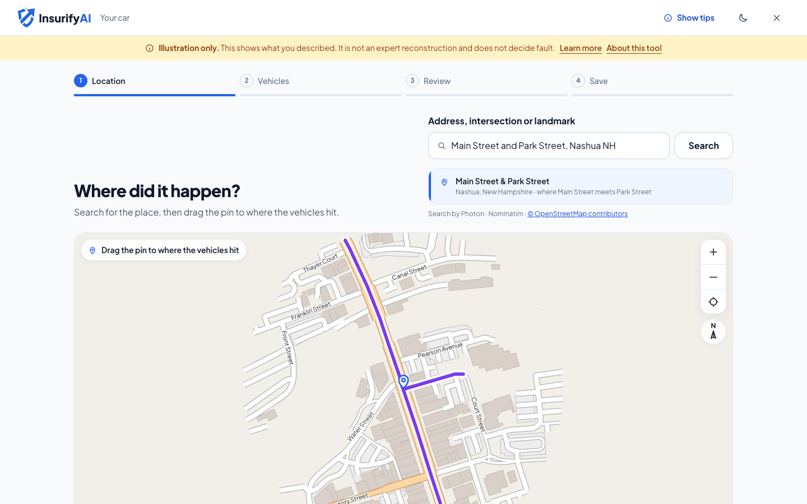
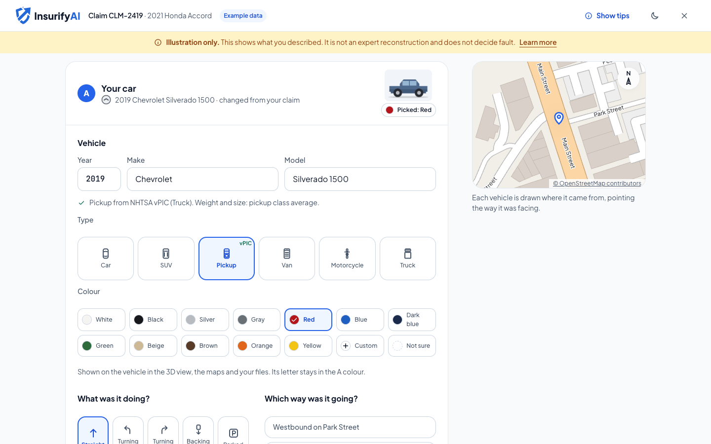
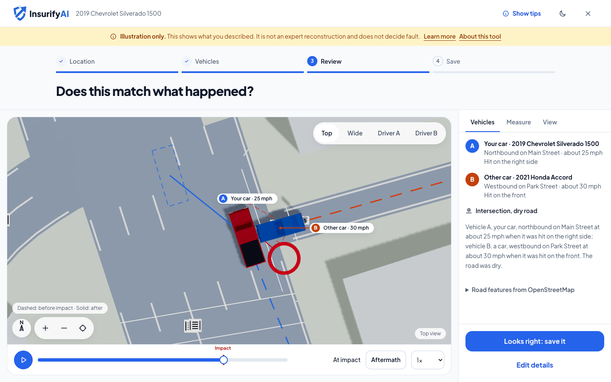
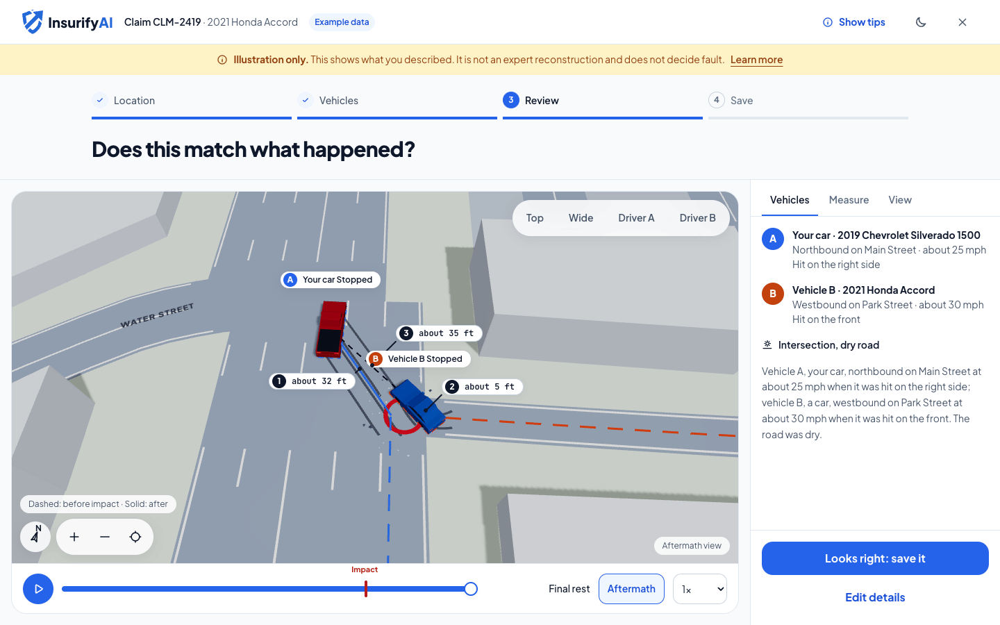
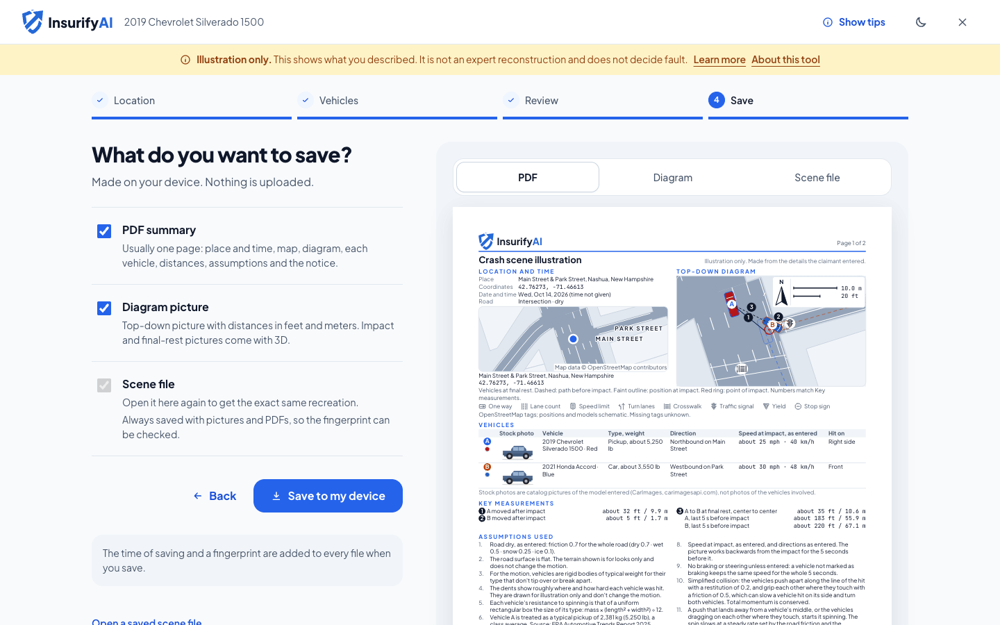
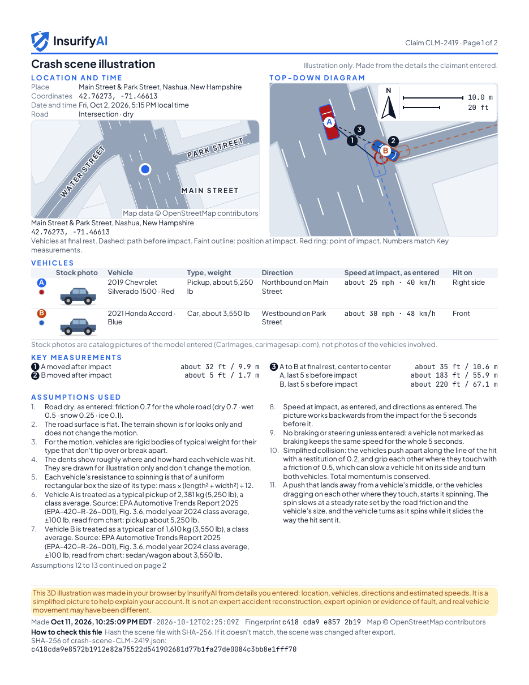
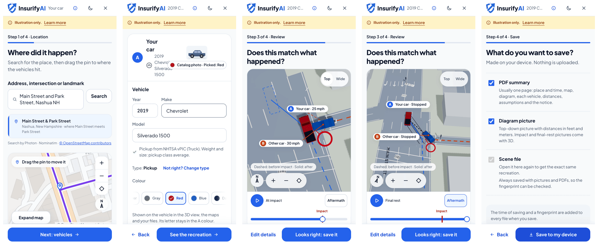

# crash-scene-3d

A browser tool that turns a driver's account of a car crash into a 3D illustration on the real road layout from OpenStreetMap. The claimant enters the place, the vehicles, their directions and speeds, and where each one was hit; a small, fixed physics model shows the vehicles arriving, touching and coming to rest. The PDF, pictures and scene file are all made in the browser, and every one of them says it illustrates what the claimant described and does not decide fault.

**[Live demo](https://crash-scene-3d.netlify.app)** · [T-bone example](https://crash-scene-3d.netlify.app/?example=t-bone-intersection#review) · TypeScript · React · three.js · OpenStreetMap · [MIT license](LICENSE)


Recorded from a local fixtures build (`VITE_FIXTURES=1`) with synthetic data: a made-up claim on real public roads in Nashua, NH, with synthetic car photos and 3D models. Illustration only. [MP4 version](docs/media/demo-flow.mp4)

A second clip plays the T-bone example back from every camera (Top, Wide, and both driver views) with the live catalog vehicle models: [all-angles MP4](docs/media/crash-3d-all-angles.mp4). The example scenes now ship their cached road data, so `?example=` opens instantly from cache and never waits on a live map request.

crash-scene-3d was built as a browser tool for InsurifyAI. It is an illustration of what the claimant described; it does not find out what happened. Every screen and every file carries one of these two disclaimers:

> **Short disclaimer (screens, PNGs):** "Illustration only. This shows what you described. It is not an expert reconstruction and does not decide fault."
>
> **Long disclaimer (PDF, scene file, info popover):** "This 3D illustration was made in your browser by InsurifyAI from details you entered: location, vehicles, directions and estimated speeds. It is a simplified picture to help explain your account. It is not an expert accident reconstruction, expert opinion or evidence of fault, and real vehicle movement may have been different."

Both texts are DESIGN.md section 3, word for word. They are the constants `DISCLAIMER_SHORT` and `DISCLAIMER_LONG` in `packages/core/src/contracts/exports.ts`.

- Design (locked): `DESIGN.md`, `design/`
- How to work in this repo: `CLAUDE.md`
- Where the build stands: `PROGRESS.md`

## Screenshots

The GIF at the top walks through the whole flow. The stills below come from the same script on a local fixtures build (`node scripts/record-demo-full.mjs --stills=desktop` and `--stills=phone`), so the car photo, badge and 3D model are the synthetic fixture files (`?media=on`), not real pictures.

### How it works, step by step

A first visit opens a short welcome (what the tool is, the illustration disclaimer, four steps, "Try an example"); it is not shown again on that browser, and never on an example or shared link. The header follows vehicle A as it is typed; the claim number is optional (a saved file without one is named by date and time).

1. **Location.** Search "Main Street and Park Street, Nashua NH", pick the crossing, and the pin lands where the two streets meet (drag it to where the vehicles hit). The road surface is asked here too, with nothing picked; the demo answers Dry. Left unanswered, the picture uses dry-road grip and the files say the road surface was not given.

   

2. **Vehicles.** Nothing is prefilled. Type year, make and model (NHTSA vPIC fills the type and size class; or pick the type), pick a colour, what each vehicle was doing, then the direction (the choices come from the roads at the pin: "Northbound on Main Street", "From Park Street onto Main Street, northbound", "Out of a driveway or parking lot on the east side of Main Street") and where each vehicle was hit. A direction the roads can't carry is fixed here, with one tap, before Review.

   

3. **Review at impact.** The 3D recreation in the Top view, with the timeline set to the moment of impact.

   

4. **Aftermath.** One tap shows where both vehicles came to rest, with the path before impact dashed.

   

5. **Save.** "Looks right: save it" leads to the save step, with a preview of each file; "Save to my device" makes the PDF, PNGs and scene file in the browser and saves them as one ZIP.

   

6. **The PDF.** Page 1 of the saved report: place, map, the top-down diagram of the whole crash with the key to the road symbols under its caption, vehicles with stock photos, key measurements, assumptions, the long disclaimer and the SHA-256 fingerprint. This one runs to a second page for the last assumptions.

   

On a phone (390 px, Pixel 7), the same steps:



### Best cases to try

- [T-bone at an intersection](https://crash-scene-3d.netlify.app/?example=t-bone-intersection#review): a side impact at a crossing: play the timeline, tap the Impact mark, then compare the Top, Wide and driver views.
- [Highway rear-end](https://crash-scene-3d.netlify.app/?example=highway-rear-end#review): a same-direction hit at highway speed: the Measure tab shows how far each vehicle moved after the impact.
- [Parking lot backing](https://crash-scene-3d.netlify.app/?example=parking-lot-backing#review): a slow backing collision in a lot: look at Aftermath, where low speeds mean little movement after the touch.
- The auto-fix: start [your own claim](https://crash-scene-3d.netlify.app/), pick the Main & Park crossing and go to the vehicles step. Answer both cards (nothing is prefilled): A going straight northbound on Main, B going straight westbound on Park, A at 25 mph and B at 30 mph, B hit in front and A hit on the left. The vehicles step offers "Change A's hit side to Right side", the side that fits the directions; one tap applies it.

### What's real vs illustrated

- **Real:** road layouts and features (lanes, crossings, buildings) from OpenStreetMap; vehicle data (makes, models, body type) from NHTSA vPIC.
- **Catalog, not the vehicles involved:** stock photos and 3D models from CarImages (watermarked on the free plan). In the recordings above they are synthetic fixture files.
- **Illustrated:** the physics. A small fixed model makes the vehicles arrive, touch and come to rest plausibly from the details entered. It is an illustration, not an expert reconstruction, and it does not decide fault.

## Live URL

- App: https://crash-scene-3d.netlify.app (Netlify, with the `/api/*` proxy function)
- Repo: https://github.com/zohebzma2-cmyk/crash-scene-3d

## Development

### Quick start

Needs Node 22 or newer and npm 11. npm 10 crashes on Vitest's peer set.

```text
npx -y npm@11.20.0 install
npm run dev          # Vite, http://localhost:5173
npm test             # unit tests (vitest run)
npm run e2e          # Playwright against the built app in fixtures mode
./check.sh           # everything below, in order, stops at the first failure
npx netlify dev      # the /api proxy locally, http://localhost:8888
```

Property tests (`packages/core/test/property/`, fast-check with a fixed seed) run 1,000 random scenes through the physics (momentum, typed speed at impact, no pass-through, finite numbers, determinism) and fuzz the scene parser on every `npm test`. For a deeper run: `FC_RUNS=20000 npx vitest run packages/core/test/property`; `FC_SEED=<n>` tries another seed and `PROP_STATS=<file>` writes the coverage counts.

`./check.sh` runs: typecheck, ESLint, stylelint, the design-token check, unit tests, the build, and e2e (Chromium at desktop 1440 x 900 and phone 390 x 844, plus the WebKit `@xb` subset at both sizes; see Browser tests below).

`npx netlify dev` is on the ask-first list for agents (see the Guardrails note). Without `PROXY_USER_SALT` the function still starts, but outside `netlify dev`, the in-memory store (`NETLIFY_LOCAL_MEMORY_STORE=1`) and tests it answers every request with a 500 ("This service isn't set up yet. Please try again later."). Never put the salt in the repo.

### Fixtures mode

Fixtures mode serves the cached map data from `examples/` and never calls `/api`.

- `?fixtures=1` works only in a dev server or in a build made with `VITE_FIXTURES=1`. A normal production build ignores it and does not contain the cached map data. `npm run e2e` builds with `VITE_FIXTURES=1`.
- `?example=<name>` opens an example scene on the review step. The names are `t-bone-intersection`, `highway-rear-end` and `parking-lot-backing`. In a production build it loads only the scene file and uses the real services. In a dev or fixtures build it also turns fixtures mode on.
- The three examples are made-up claims on real public roads in Nashua, NH. Each has `scene.json`, `osm.json`, `terrain/` and `ATTRIBUTION.md`.
- Catalog 3D models in fixtures mode come from two synthetic GLBs in `apps/web/fixtures/models/` (made by `node scripts/make-fixture-glb.mjs`): make "Synthetic", model "Box car" (named Body / Glass / Tire materials) or "Baked car" (one material with the paint baked into its texture, like the catalog's). Every other vehicle keeps our own model.

### Browser tests (Playwright)

The e2e suite builds the app with `VITE_FIXTURES=1` and serves it on `E2E_PORT` (default 4173). Projects:

| Project | Engine, size | Runs |
|---|---|---|
| `desktop`, `phone` | Chromium (SwiftShader WebGL), 1440 x 900 and 390 x 844 | every spec |
| `webkit-desktop`, `webkit-phone` | WebKit, 1440 x 900 and 390 x 844 (iPhone 15) | the cross-browser subset: tests tagged `@xb` |

```text
npx --no-install playwright install chromium webkit   # once
npm run e2e          # default: Chromium everything + WebKit @xb (what check.sh runs)
npm run e2e:xb       # only the @xb subset, on every project
npm run e2e:full     # E2E_FULL=1: every spec on every project
```

- `@xb` covers the full flow, the three examples opening and playing, Aftermath, the Measure tab, the search dropdown, the saved ZIP and what each engine draws. Tag a test by putting `@xb` in its title.
- `e2e/engines.spec.ts` logs what each engine draws on Review (`[renders] ...`): headless WebKit on macOS has real WebGL (Apple GPU) and draws the 3D view, as Chromium does with SwiftShader. The 2D fallback is only used without WebGL; a test switches WebGL off to check it.
- `e2e/axe-steps.spec.ts` runs axe (every impact, WCAG 2.x A/AA + best practice) on every step and state in light and dark.
- `e2e/download.spec.ts` unpacks the saved ZIP for each example and checks every file in it (names, scene file against the app's schema, PDF, every PNG's size, footer band and the footer text drawn into it).
- Chrome-only tests (CDP CPU throttling) skip on WebKit with a reason.

### README media

The GIF, the MP4 and the step pictures above come from one script, run on a local fixtures build. Every run needs ffmpeg (`FFMPEG=/path/to/ffmpeg`):

```text
node scripts/record-demo-full.mjs                             # docs/media/demo-flow.gif and .mp4
node scripts/record-demo-full.mjs --stills=desktop --no-build  # docs/media/steps/desktop-*.png, with page 1 of the PDF
node scripts/record-demo-full.mjs --stills=phone --no-build    # docs/media/steps/phone-strip.png
```

- It builds with `VITE_FIXTURES=1` (`--no-build` reuses that build), serves it on `DEMO_PORT` (default 4521) and drives Chromium with Playwright; the video is 1280 x 720.
- The video opens on the first-visit welcome and dismisses it; the stills start with it already seen.
- A fixtures build shows an "Example data" chip on every screen. The live site shows it only on an example, so the recordings hide it.
- The PDF still needs `pdftoppm` and `unzip`. The phone run also writes one picture per step (`phone-<step>.png`); only the strip is committed.

## Architecture

npm workspaces. Versions are pinned to releases at least two weeks old.

| Package | Owns | Purity rules |
|---|---|---|
| `packages/core` | Contracts (zod Scene v4, RoadNetwork, SimulationResult, exports, proxy routes and `ProviderConfig`), physics, projection, placement, lanes, the formatter, canonical JSON and SHA-256, vehicle presets | Pure TypeScript. No DOM, no three, no React (ESLint enforces it). SI units. Runs server-side later. |
| `packages/mapdata` | Overpass JSON to RoadNetwork, "X and Y" crossings, search-result merging, Overpass query builders, Terrarium decoding and the terrain grid | Pure TypeScript. No DOM. Fetching is injected or done by the proxy. |
| `packages/exports` | The PDF (pdf-lib, fonts embedded), PNG pictures, the scene file | Canvas and fonts are injected, so it can run on a server later. |
| `packages/proxy` and `netlify/functions/api.mts` | The `/api/*` proxy to Nominatim, Overpass, OSM tiles, Terrarium and NHTSA vPIC | Server only. Every provider detail lives in one `ProviderConfig` value. |
| `apps/web` | The 4-step flow, the 3D viewer (react-three-fiber), the map (react-leaflet) | Shows text only, never HTML. Colors, sizes and spacing come from design tokens. |

### Data flow

1. The claimant fills in four steps: where, which vehicles, check the picture, save.
2. The state is one **Scene v4** object, checked by zod (`parseScene`). A saved scene file goes through `parseSceneFile`, which opens a v3 file as v4.
3. The pin goes to the proxy. Overpass JSON comes back and `parseOverpass` turns it into a **RoadNetwork** in local meters: ways, buildings, parking lots, terrain.
4. `checkScene` makes plain-language warnings. **Placement** snaps each vehicle to a lane and puts the vehicles in contact at the impact point.
5. `simulate` runs the approach, the impact and the slide to rest. It returns a **SimulationResult**.
6. Everything shown comes from that result through one formatter (DESIGN.md section 14): the viewer, the 2D diagram, the PDF, the PNGs and the scene file.

```text
  claimant (4 steps)                          browser | server
        |                                             |
        v                                             |
  Scene v4 (zod) <--- scene file (1 MB cap)           |
        |                                             |
        | pin lat/lon ------- GET /api/geo/overpass --+--> proxy --> Overpass
        |                     GET /api/geo/terrain/.. +--> proxy --> Terrarium
        |                     GET /api/geo/tile/..    +--> proxy --> OSM tiles
        |                     GET /api/geo/search     +--> proxy --> Nominatim
        v                                             |
  RoadNetwork (local ENU meters)                      |
        |                                             |
        v
  checkScene (warnings) -> placement (lanes, contact)
        |
        v
  simulate: approach -> impulse at t = 0 -> slide to rest
        |
        v
  SimulationResult (SI units, fixed-step tracks)
        |
        +--> formatter --> 3D viewer, 2D diagram, review text
        +--> exports  --> PDF, PNGs, scene JSON (canonical + SHA-256)
```

### The browser only talks to its own origin

Every outside call goes through the proxy at `/api/*`. The CSP has `connect-src 'self'`. Fonts are self-hosted. The browser only ever calls its own origin. It never holds a provider key or the contact string. (The `/api/geo/overpass` response does carry a `source` field with the mirror URL that answered, as data only. The browser does not call it.)

### Proxy routes

All routes are GET. Any other method gets 405. The proxy rejects unknown and repeated query parameters.

| Route | Parameters | Goes to |
|---|---|---|
| `/api/geo/search` | `q` (2 to 200 characters), `limit` (1 to 5, default 5) | Nominatim, with `format=jsonv2&addressdetails=1` |
| `/api/geo/overpass` | `lat`, `lon`, `radius` (50 to 400 m) | Overpass, three mirrors in order. The query is built server-side. |
| `/api/geo/crossing` | `a`, `b` (2 to 80), `near` (up to 120) | Nominatim for `near`, then Overpass. Falls back to a plain search. |
| `/api/geo/tile/{z}/{x}/{y}.png` | none | OSM tiles, zoom 19 at most |
| `/api/geo/terrain/{z}/{x}/{y}.png` | none | AWS Terrarium tiles, zoom 15 at most |
| `/api/vehicles/makes` | none | NHTSA vPIC makes (cars, MPVs, trucks, motorcycles) |
| `/api/vehicles/models` | `make`, `year` (1950 to the current year + 2) | NHTSA vPIC models |
| `/api/vehicles/image` | `make`, `model`, `year` (optional), `view` (8 angles, default `front34`), `width` (200, 400, 800, 1200; default 400), `type` (`car`, `moto`) | CarImages catalog, then its CDN. 200 picture, or 204 with `X-Media-Fallback` |
| `/api/vehicles/model` | `make`, `model`, `year` (optional) | CarImages 3D model (GLB). 200 `model/gltf-binary` with `X-Vehicle-Model-Watermarked`, or JSON `{ fallback: true, reason }` |
| `/api/logos/make` | `name` | CarImages brand logo, then logo.dev's API, then CarImages' makes logo. 200 PNG with `X-Logo-Source`, or 204 |

Errors are JSON `{ code, message, retryAfterS? }` with `code` one of `busy`, `timeout`, `upstream`, `bad-request`, `not-found`. The overall deadline for one request is `limits.timeoutMs` = 8000. The three media routes never answer an error for a provider problem: no keys, quota, our limits, a failing provider or nothing found all come back as their fallback, and the app shows its own icon (docs/decisions/0011-vehicle-images.md).

## The physics

This section follows the code in `packages/core/src/physics/` (`PHYSICS_VERSION` = "3.0.0"). Constant names are in code font. Change a constant and the model changes with it.

### Units and frames

- Inside the physics everything is SI: meters, seconds, kilograms, radians, m/s. mph, feet, km/h and degrees appear only at the boundary: the formatter and the rendering helpers.
- `MPH_TO_MPS` = 0.44704 (exact). `M_TO_FT` = 1 / 0.3048 (exact). `G_MPS2` = 9.80665.
- Local frame: x = east, y = north. A `Pose` heading is a compass bearing in radians (0 = north, clockwise). Spin inside the impact and slide code is counter-clockwise positive, so the compass heading rate is the negative of the spin.
- Rounding happens only in the formatter. Distances print to the whole foot and 0.1 m. Weights print to the nearest 10 lb. Speeds depend on the output:
  - `formatSpeed` rounds to the whole mph and km/h. It is used for the speeds on the review screen, the viewer labels, the PDF vehicles table and the PDF braking and "not sure" notes.
  - `formatSpeedExact` prints the typed or scanned speed to 0.1 mph (a whole number has no decimal), for example "22.5 mph". It is used in the sentences the physics writes: the range warnings, the `speed-range` assumption and the `not-moving-toward` error.

### The local ENU projection

One equirectangular projection about the frame origin, used by core and (as its own copy) by mapdata. With phi the origin latitude:

```text
mPerDegLat = 111132.92 - 559.82 cos(2 phi) + 1.175 cos(4 phi) - 0.0023 cos(6 phi)
mPerDegLon = 111412.84 cos(phi) - 93.5 cos(3 phi) + 0.118 cos(5 phi)
x = (lon - lon0) * mPerDegLon        (east)
y = (lat - lat0) * mPerDegLat        (north)
```

The comment in `projection.ts` puts the error at about 2 cm at 400 m against a full ellipsoidal projection. It warns against a spherical radius: the 0.09 % scale difference would move roads about 23 cm against the pin at 250 m. `toLatLon` is the exact inverse.

### What the typed speed means

**The typed speed is the speed at impact.** The picture works backwards from the impact over `APPROACH_S` = 5 s.

- A vehicle not marked as braking holds its speed for the whole window.
- A vehicle marked as braking (and moving) slows down into the crash. It decelerates at `a = BRAKE_FACTOR * mu * G_MPS2` with `BRAKE_FACTOR` = 0.7, over the last `BRAKING_S` = 1.5 s. Before that it holds a steady speed. So it is faster earlier and can never be shown stopping before the crash.

With tau the seconds before the impact (tau >= 0), B = `BRAKING_S`, m = min(tau, B), and v_i the speed at impact:

```text
v(tau) = v_i + a * m
s(tau) = v_i * tau + a * m^2 / 2 + a * B * max(0, tau - B)
a      = 0 when the vehicle is not braking
```

`s(tau)` is the distance covered in the last `tau` seconds. The vehicle's centre follows its lane line, shifted sideways and along by the offset it has at the impact. The track is sampled every `DT_S` = 1/120 s, so the window is 600 steps (601 samples including t = 0). The distance is measured along that path.

### The impact

Two bodies meet at t = 0 at the contact point. The hit is a planar impulse with two parts: one along the contact normal (restitution) and one along the contact surface (contact friction). Each body is a rigid rectangle (length L, width W, mass m) with the yaw inertia of a uniform box: `I = m (L^2 + W^2) / 12`.

```text
P = Jn n + Jt t          t = (-n.y, n.x)

v1' = v1 + P / m1        w1' = w1 + (r1 x P) / I1
v2' = v2 - P / m2        w2' = w2 - (r2 x P) / I2
```

- `n` is the unit contact normal from body 2 into body 1. It is the smallest-overlap axis of the two rectangles. `r` is the vector from a body's centre to the contact point. `r x P` is the 2D cross product.
- **Normal part.** The contact points separate at `e` times their closing speed, with `e` = `RESTITUTION` = 0.2. For a hit through both centres this is the familiar `Jn = (1 + e) v_close / (1/m1 + 1/m2)`.
- **Contact friction (Brach's planar impact model).** A front end driven into a side grips it. The tangential impulse `Jt` is the one that stops the two surfaces sliding past each other at the contact point (no slip left after the hit), but never more than `CONTACT_FRICTION` times the normal impulse: `|Jt| <= mu_c Jn` with `mu_c` = `CONTACT_FRICTION` = 0.5. If the cap is reached, the surfaces keep sliding and `Jt = mu_c Jn`, against the slip. In a hit with no slip (a rear-end in one lane, a head-on) `Jt` is 0, so those results do not change.
  - The sticking impulse comes from the 2 x 2 system `K [Jn, Jt] = [-(1 + e) v_n, -v_t]`, with `K` the response of the relative contact velocity to a unit impulse. It uses both masses and both lever arms.
  - In a strongly coupled corner hit, the normal impulse itself can carry the slip through zero (about one sliding corner hit in eight). Friction does not cause it; it happens with no friction too. It is energy-safe.
  - Energy guard: if the grip would add kinetic energy (a rare corner hit), it is blended back toward the normal-only impulse until the energy stops rising. Momentum and angular momentum are conserved either way, because every impulse is equal and opposite at one point.
  - Sources: R. M. Brach, *Mechanical Impact Dynamics* (Wiley, 1991) and Brach and Brach, *Vehicle Accident Analysis and Reconstruction Methods* (SAE); Steffan and Moser, SAE 960886 (restitution plus contact friction, a "full impact"). The value 0.5 is a typical figure for sheet metal on sheet metal, not a measurement. It is marked unverified in `constants.ts`. The T-bone result does not change for any value from 0.45 up.
- **Spin comes from the lever arm.** `w' = w + (r x P) / I`, summed over the normal and tangential parts and over the points of the contact patch. A hit through the centre of mass gives no spin. An off-centre hit does. A long or heavy vehicle spins less for the same push, because `I` is larger. The spin slows afterwards (below).
- **Touching at t = 0.** Placement leaves each pair exactly touching (penetration at most 5 mm, gap at most 2 cm): the two bodies share the correction along the contact normal.
- The impulses act at the contact patch: first the midpoint of its two ends measured along the contact face, then the two ends, so one end of two touching faces cannot be left still closing. Face against face (within 10 degrees of parallel), the ends are the ends of the stretch where the two faces overlap, halfway between the faces, so a degree or two of tilt does not move the point. A corner on a face gives a short patch from the overlap of the two bodies each grown evenly by 3 cm. If `v_rel . n >= 0` at a point, nothing changes there.
- Before the impulse, each vehicle moves along its travel bearing at its speed at impact (a backing vehicle travels opposite to the way it faces) with zero spin. A parked vehicle is a body at rest.
- Three or four vehicles at t = 0 resolve as sequential pairwise impulses on the touching pairs, in letter order (A-B, then A-C and so on), repeated `IMPACT_PASSES` = 4 times. The extra passes keep a later pair from leaving an earlier pair closing again. There are no later collisions.
- Two vehicles count as hitting each other only if they close along the normal faster than `MIN_CLOSING_MPS` = 0.05 m/s.

Worked example (a car going north at 25 mph, hit on its left side by an SUV going east at 20 mph, dry road): `Jn` = 9,704 N s, `Jt` = -4,302 N s (it grips: 0.44 of `Jn`). The car leaves at 10.4 m/s and turns left at 1.12 rad/s. The SUV leaves at 4.7 m/s and turns left at 2.22 rad/s. The car slides 7.9 m (26 ft) and turns 7.8 degrees. The SUV slides 1.6 m (5 ft) and turns 31 degrees. The full steps are in `packages/core/test/yaw.test.ts`.

### After the impact

Each vehicle slides on its own, with the friction of the whole road: `mu` = `FRICTION[condition]`.

| Road condition | `FRICTION` (mu) |
|---|---|
| dry | 0.7 |
| wet | 0.5 |
| snow | 0.25 |
| ice | 0.1 |

- **Translation:** straight along the post-impact velocity, decelerating at `mu * G_MPS2`. With speed v0 it stops after `t = v0 / (mu * g)` and `d = v0^2 / (2 * mu * g)`.
- **Spin law (the yaw model):** the spin `w0` left by the impact slows at a constant rate `alpha = mu * G_MPS2 / k`, where `k = sqrt(I / m)` is the radius of gyration. A friction force `mu m g` over a body of size `k` resists spin with a torque of about `mu m g k`, and `I = m k^2`, so `alpha = mu g / k`. It does not depend on the translation. The spin is `w(t) = w0 - sign(w0) alpha t`. It stops at `t_yaw = |w0| / alpha`, after the heading has turned through `w0^2 / (2 alpha)`. So a vehicle can keep turning briefly after it stops sliding, or stop turning before it stops sliding. The heading integrates the spin. The slide follows the velocity, not the heading, so a vehicle can slide sideways while it turns. The compass heading falls by the turned angle (counter-clockwise spin turns the heading toward west).
- **After the crash each vehicle is treated as skidding,** slowing at the road friction until it stops, even where a vehicle rolling free would slow less. This is the simple, honest choice: the claimant does not say whether a driver braked after the hit.
- **Bodies never overlap.** There are no later collisions, so a body that would slide into another stops at its last clear sample, with zero velocity and spin, and the warning `stopped-at-vehicle` says so. This is the same rule as for a building wall. It keeps the gap at rest equal to a real centre distance, never about 0 ft.
- A vehicle whose rectangle reaches a building footprint during the slide stays at its last clear sample, with zero velocity and spin. A warning (`stopped-at-building`) says so.
- Fixed step `DT_S` = 1/120 s. The slide runs until both translation and spin are done, and the last sample is exactly at rest. The track ends two samples after the last vehicle stops.
- The model is deterministic. The same inputs always give the same picture.

### "Not sure" speeds

- The claimant can answer "Not sure" and give a posted limit (5 to 85 mph, `LIMITS`), or leave it unknown. Typed speeds and limits must be whole or tenths of a mph. Finer values are rejected with "Use whole or tenths of a mile per hour, like 25 or 25.5." The picture uses the limit. The numbers shown cover limit - `RANGE_HALF_MPH` to limit + `RANGE_HALF_MPH`, with `RANGE_HALF_MPH` = 5. If the limit is unknown the model uses `DEFAULT_LIMIT_MPH` = 25.
- The scan runs the speeds from limit - 5 to limit + 5 mph in `RANGE_STEP_MPH` = 0.5 mph steps: 21 speeds. All "not sure" vehicles move together.
- A speed works only if all three hold: the contacts close faster than `MIN_CLOSING_MPS` at the impact; no two vehicles overlap by more than `OVERLAP_TOLERANCE_M` = 0.05 m at any sample in the 5 s window; no vehicle overlaps a building in the window.
- The picture uses the middle speed if it works, else the nearest speed that does (the lower one on a tie). The range shown is the contiguous run of working speeds that holds the picture speed, from three full runs: the low end, the picture speed and the high end. Working speeds cut off by failing ones are left out.
- If no speed works, there is no picture and the error `no-workable-speed` says why.
- When the range narrows, the result carries plain warnings: `range-start` and `range-end` (only when every speed beyond the cut fails), `picture-speed` (the middle speed does not work), and `range-gap` (working speeds left out, one entry per separate run). For example: "At 22 mph and below, vehicle B wouldn't have reached vehicle A, so the numbers shown start at 22.5 mph."

### Gaps

`SimulationResult.gaps` lists only pairs of vehicles that touched at the impact. Two vehicles give one entry. A chain A-B-C gives A-B and B-C, never A-C. The value is the centre-to-centre distance at final rest, as a low, picture and high value over the three runs. Bodies do not overlap at rest, so the gap is at least half the sum of the two widths.

### Impact data for the renderer

Each vehicle in a contact has an optional `impact` object on its `VehicleResult`: `deltaVMps` (size of the velocity change, low / picture / high), `contactPointM`, `normal` (the direction the hit pushed this vehicle), `spinRadps` (spin right after the impact, low / picture / high, positive clockwise seen from above, the same sense as the heading in the track), `zoneHit` (the zone the claimant entered) and `leadingZone` (the zone of this vehicle's body that touched; for the striker it can differ from the entered zone). A renderer that does not find it reads the track.

### Lane snapping and checks

- Traffic is right-hand. Lanes are numbered from the right for the direction of travel: lane 0 is the rightmost. The offset is measured to the right of travel, with N lanes in that direction, lane index i and lane width w (`laneWidthM`):

```text
two-way road:   offset = (N - 1/2 - i) * w
one-way road:   offset = ((N - 1)/2 - i) * w     (full width, centred on the way line)
```

- Default lane: 0 for going straight and backing. For a turn: the leftmost lane (N - 1) for a left turn, lane 0 for a right turn, on both the approach and the exit.
- One street is often several OSM pieces. The street is its name, or its route ref when it has no name. `lanePath` chains the connected pieces of the same street: pieces meet when their end nodes are within 1.0 m, at a fork it takes the straightest piece, and it never joins at a turn of more than 100 degrees. It reaches `CHAIN_REACH_M` = 416 m past each end (computed from the fastest typed speed, 150 mph, braking on dry road, plus 50 m). The lane keeps its number from the right. Where the lane count changes the offset tapers linearly over `LANE_TAPER_M` = 30 m.
- Which road a vehicle is on: the road id in the scene, else a road within `NEAR_PIN_M` = 25 m with the vehicle's road name and aligned within 30 degrees, else the nearest aligned road. With no match the path is a straight line through the pin and the warning `path-not-on-road` says so. With no road data at all the model uses a flat template.
- Turns are circular arcs from the approach lane to the exit lane, radius `TURN_RADIUS_LEFT_M` = 10 m for left and `TURN_RADIUS_RIGHT_M` = 6 m for right (smaller if the legs are too short).
- Placement: for two vehicles the contact point is where the two paths cross nearest the pin (for a rear-end, the pin's projection onto the shared lane). Each vehicle is placed so its marked zone touches that point. If they would overlap, the contact slides along the struck side in 0.25 m steps. For three or four vehicles, each marked zone is matched to the other vehicle that can hit it. A hit faces its zone when the approach comes within 90 degrees (left, right) or 67.5 degrees (every other zone).
- **No overlap before impact:** every pair of rectangles is checked at every sample of the 5 s window against `OVERLAP_TOLERANCE_M` = 0.05 m. A failure is the error `passes-through`.
- **Never on a building:** the same samples are checked against building footprints. A failure is the error `on-building`. After the impact the slide stops at the wall (above).
- **Paths follow the roads (2026-10-11):** a vehicle's path is its lane's centre line, chained on through name changes and back round the corner it turned in from; it is never drawn straight across open ground. A direction that follows no road at the pin is refused (`off-road-direction`), as is a turn with no road leading into it (`no-road-to-turn-from`); the Vehicles step blocks on both with one-tap fixes. A vehicle out of a driveway or parking lot (`travel.fromDriveway`) starts `DRIVEWAY_M` = 20 m off the road. With less road behind it than its approach needs, a vehicle starts from a stop there and speeds up evenly (an assumption with its rate); more than `MAX_START_ACCEL_MPS2` (0.5 g, unverified) is refused (`start-too-short`). Two paths that don't meet near the pin are refused (`paths-dont-meet`).
- **Drivable area:** every 6th sample (0.05 s) of the approach, a vehicle with a corner off the drivable area (each direction's lanes plus 0.3 m, a parking lot, or a junction's inside corner up to 7 m past both kerbs) gets the warning `off-road`, "runs over the edge of the road before the crash". Samples within 10 m of the edge of the road data are skipped, because no data is not off-road. It never blocks.

## Assumptions

`simulate()` builds this list. The PDF prints every item, numbered, and the scene file stores it under `derived.assumptions`. Each item has an id. Numbers are filled in from the constants above.

| Id | Printed when | Text |
|---|---|---|
| `friction` | always | Road {dry, wet, snowy, icy}, as entered: friction {mu} for the whole road (dry 0.7 · wet 0.5 · snow 0.25 · ice 0.1). |
| `flat-ground` | always | The road surface is flat. The terrain shown is for looks only and does not change the motion. |
| `rigid-bodies` | always | For the motion, vehicles are rigid bodies of typical weight for their type that don't tip over or break apart. |
| `damage-illustrated` | some vehicle's change of speed in the hit is over 3 mph | The dents show roughly where and how hard each vehicle was hit. They are drawn for illustration only and don't change the motion. |
| `inertia` | always | Each vehicle's resistance to spinning is that of a uniform rectangular box the size of its type: mass × (length² + width²) ÷ 12. |
| `mass-A` to `mass-D` | one per vehicle | Vehicle {id} is treated as a typical {type} of {kg} ({lb}), {basis}. Source: {preset source}. |
| `entered-speed` | always | Speed at impact, as entered, and directions as entered. The picture works backwards from the impact for the 5 seconds before it. |
| `no-braking-default` | always | No braking or steering unless entered: a vehicle not marked as braking keeps the same speed for the whole 5 seconds. |
| `start-from-stop-A` to `start-from-stop-D` | a vehicle has less road (or driveway, or lot) behind it than its approach needs | Vehicle {id} has about {distance} of {road or lot behind it / a driveway or parking lot before the road}, so the picture starts it from a stop there and speeds it up evenly to {speed} at the crash, at {a}. (Over 0.5 g, `MAX_START_ACCEL_MPS2`, unverified, the crash is refused: `start-too-short`.) |
| `braking-deceleration` | a moving vehicle is marked as braking | A vehicle marked as braking slows down into the crash over the last 1.5 seconds, at 0.7 × the road friction × gravity, {a}. It is never shown stopping before the crash. |
| `restitution` | always | Simplified collision: the vehicles push apart along the line of the hit with a restitution of 0.2, and grip each other where they touch with a friction of 0.5, which can slow a vehicle hit on its side and turn both vehicles. Total momentum is conserved. |
| `multi-impact` | three or four vehicles | With {n} vehicles, each touching pair is resolved one at a time at the same instant, in letter order, 4 passes. There are no later collisions. |
| `yaw` | always | A push that lands away from a vehicle's middle, or the vehicles dragging on each other where they touch, starts it spinning. The spin slows at a steady rate set by the road friction and the vehicle's size, and the vehicle turns as it spins while it slides the way the hit sent it. |
| `post-impact-slide` | always | After the impact each vehicle is treated as skidding: it moves in the direction the hit sent it, slowing at the road friction × gravity ({mu·g}) until it stops, even where a vehicle rolling free would slow less. Any spin slows at a steady rate set by the road friction and the vehicle's size, and can carry on briefly after it stops sliding. There are no later collisions: a vehicle that would slide into another stops where they touch. |
| `time-step` | always | The motion is worked out in fixed steps of 1/120 s, so the same inputs always give the same picture. |
| `speed-range` | any "not sure" speed | Where a speed is "not sure", the picture uses the posted limit{ (around 25 mph, a typical city limit, if it isn't known)}, and the numbers shown run from 5 mph below to 5 mph above it. When the scan narrowed the range, a sentence is added: "Here the crash only works for vehicle {id} at {lo} to {hi}, so the numbers shown cover that" (with ", and the picture uses {x}" if the picture speed moved, and "The other "not sure" speeds move with it." for several vehicles). If working speeds were left out: "Here the crash works for vehicle {id} at {lo} to {hi}, and that is what the numbers shown cover; other speeds that work are left out." |
| `turn-radius-left` | a vehicle turns left | A vehicle turning left follows a circular arc with a radius of 10 m. |
| `turn-radius-right` | a vehicle turns right | A vehicle turning right follows a circular arc with a radius of 6 m. |

The mass line is built from `PRESETS`. Example: "Vehicle A is treated as a typical car of 1,610 kg (3,550 lb), a class average. Source: EPA Automotive Trends Report 2025 (EPA-420-R-26-001), Fig. 3.6, model year 2024 class average, ±100 lb, read from chart: sedan/wagon about 3,550 lb." The motorcycle line has no source: "Vehicle A is treated as a typical motorcycle of 230 kg (510 lb), a typical value without a published source."

## Limits

Read these before you rely on a picture.

- **Flat road.** There is no slope, banking or camber in the motion. Terrain is visual only: it never changes a speed, a distance or a stopping point.
- **Rigid bodies.** Each vehicle is a rectangle of class-average weight and size. Nothing deforms in the motion; the dents and crumple in the 3D view are drawn for illustration only. The exact vehicle is rarely known, so the presets stand in for it.
- **No secondary collisions after t = 0.** After the impact each vehicle slides on its own. Vehicles do not hit each other again. Only buildings stop a slide.
- **Turns are arcs.** A turn is a circular arc of `TURN_RADIUS_LEFT_M` = 10 m or `TURN_RADIUS_RIGHT_M` = 6 m, not a measured path. There is no steering, no swerving and no skid before the impact.
- **No roundabouts.** OSM roundabouts parse as one-way roads, and nothing in placement understands a circular junction.
- **Centre turn lanes.** OSM `lanes` counts a centre two-way turn lane, but `RoadWay` has no field for it. With only a total, an odd count gives the extra lane to the forward side, so a 5-lane road with a centre turn lane reads as 3 forward and 2 backward. When `lanes:forward` and `lanes:backward` are both tagged, they are used as they are. Treat odd lane counts as approximate.
- **OSM data quality.** Roads, lane counts, widths, one-way flags, speed limits and buildings are volunteer data and can be missing or wrong. Lane width defaults to 3.5 m and is clamped to 2.5 to 4.5 m when a width is tagged. Building height defaults to 6 m (3 m per level). Check the map against what you know.
- **The road area is a square.** The tool loads roads in a square with a half-size of 250 m around the pin (`ROAD_RADIUS_M` = 250 in the app), so 500 m on a side. The proxy accepts 50 to 400 m. Nothing outside it exists for the tool.
- **Vehicle presets.** Class values, not the real vehicle. Sources, from `packages/core/src/presets.ts`:

| Type | Mass | Mass source | Length × width (m) | Size source |
|---|---|---|---|---|
| Car | 1,610 kg | EPA Automotive Trends Report 2025, Fig. 3.6, MY2024 sedan/wagon, read from chart (±100 lb) | 4.8 × 1.85 | none yet |
| SUV | 2,064 kg | same, truck SUV | 4.85 × 1.95 | none yet |
| Pickup | 2,381 kg | same, pickup | 5.8 × 2.1 | AASHTO passenger-car design vehicle (2001), via FHWA 2017 vehicle inventory; secondary |
| Van | 2,155 kg | same, minivan/van | 5.15 × 2.0 | none yet |
| Motorcycle | 230 kg | **none. No published source.** A typical value. | 2.15 × 0.85 | width from patent literature, 28 to 39 in; secondary; length none |
| Truck | 8,845 kg | FHWA vehicle weight class 6 lower bound (19,501 lb GVWR), treated as a loaded single-unit truck | 9.2 × 2.4 | AASHTO single-unit truck design vehicle (2001), via FHWA 2017; secondary |

- Every size is flagged `verified: false`. The motorcycle mass is flagged `verified: false` too. They need a primary source before release.
- vPIC types map to presets: Passenger Car to car; MPV to SUV (van for known van models); Truck to pickup, or truck for heavy chassis models, or van; Motorcycle to motorcycle. Anything else asks the claimant.
- **Catalog paint vs the picked colour.** Catalog photos and 3D models come in the catalog's own paint. The picked colour is what every picture and file shows: it fills our model and tints a catalog model (exactly for a model with a body-paint material; close, by recolouring the paint's texels, for a paint baked into the texture), and a "Picked: Red" chip sits next to any catalog photo. A dark catalog paint (black, dark grey) can't be told apart from tyres and trim in a baked texture, so that model keeps it and the viewer says so. Vehicles are told apart by their letters and outlines, never by paint.
- **One PDF page, unless there is overflow.** If the assumptions and warnings do not fit at 8 pt, they move to page 2 (and on, if the lists are very long). Nothing is cut.
- **Speeds above 150 mph** (`LIMITS.maxSpeedMph`) are refused. So are speeds and limits finer than a tenth of a mph ("Use whole or tenths of a mile per hour, like 25 or 25.5."), so the saved file always matches what was entered.

## Exports and integrity

Files are made in the browser and saved with the browser's download. Nothing is uploaded. Any combination of formats, at least one.

| Format | File | What it is |
|---|---|---|
| Scene file | `crash-scene-{claim}.json` | Canonical JSON of the scene plus the save time, the long disclaimer, and the values the physics used |
| PDF | `crash-scene-{claim}.pdf` | US Letter, brand fonts embedded. Header, location and time, map thumbnail with "© OpenStreetMap contributors", top-down diagram, vehicles table, key measurements in ft and m, the assumptions list, warnings, footer with the long disclaimer, timestamp and fingerprint |
| Top-down diagram | `crash-scene-{claim}-diagram.png` | 1600 × 1600. Road, outlines with letters, paths, impact point, distances in ft and m, north arrow, scale bar |
| 3D stills | `...-impact.png`, `...-final-rest.png` | 1920 wide, 1920 × 1080 with the footer band. Captured from the viewer. Left out, with a plain reason, if not captured. |

- Every PNG has a footer band with the short disclaimer, the timestamp and the short fingerprint.
- The PDF map thumbnail is drawn from tiles already loaded in the visible map. It is never made by fetching tiles. If they are not available, the PDF prints "Map not available." with the coordinates.
- **The JSON is always included with a PDF or PNG.** Every PDF and PNG prints the fingerprint of the scene file, so the file it belongs to is always saved with it. The app says so ("The scene file was added so the fingerprint on the other files can be checked.").
- **One timestamp and one fingerprint per save.** All files from one save share them.
- **Canonical JSON.** Keys sorted, no whitespace, UTF-8, no trailing newline (`canonicalJson`). The file is saved in exactly that form.
- **Fingerprint.** SHA-256 of that text, by Web Crypto. Short form: the first 16 hex characters in groups of four, such as `a3f9 1c2e 77b0 4d18`. Full form: all 64 characters, printed in the PDF.
- **Timestamp.** `createdAt` is UTC, ISO 8601, to the second (`2026-10-09T20:52:18Z`). The PDF also prints the local time with the zone.
- **How to check a file.** The PDF footer says: "Hash the scene file with SHA-256. If it doesn't match, the scene was changed after export." For example, `shasum -a 256 crash-scene-{claim}.json` must print the 64 characters in the PDF.
- **What the JSON holds:** the scene, `physicsVersion`, `road.friction`, per vehicle `speedSource` (`claimant` or `not-sure`), `postedLimitMph`, `postedLimitSource` (`claimant` or `default-25`), `speedRangeMph`, `speedUsedMph` and `speedShownRangeMph`, `createdAt`, `disclaimer`, and `derived` (friction, restitution, the assumptions, the warnings, the vehicle masses and their sources). Opening it again rebuilds the same recreation, because the physics is deterministic.
- **The 8 pt rule.** Nothing in the PDF goes below 8 pt (`MIN_TEXT_PT`), including labels inside the diagram. The layout starts at the normal size and shrinks in three steps (smaller text, padding and gaps) to fit one page.
- **Page-2 overflow.** If it still does not fit at 8 pt, page 1 stays at 8 pt and keeps as many whole assumptions as fit (and, when they all fit, as many whole warnings as fit); only the rest move to page 2, and page 1 says what continues ("Assumptions 11 to 16 and details that may not fit together continued on page 2"). An item is split between pages only when it alone is taller than a page, and a heading never ends a page alone. Page 2 carries the same header, footer, disclaimer, timestamp and fingerprint. The app tells the person that this happened.
- Text from a scene is cleaned before printing: bidirectional and control characters are removed, and a short list of symbols the brand font lacks (≈ ≤ ≥ → ≠) is written as words. Any other character the font lacks prints as "?", and the app gets a note naming those characters.

## Privacy and data

**What leaves the browser.** Only requests to this site's own `/api/*`. The proxy then calls the providers. The browser never talks to a provider.

| Provider | What the proxy sends | When |
|---|---|---|
| Nominatim | the typed address text (`q`) plus fixed parameters | only when the claimant taps Search, never as they type, never reverse geocoding |
| Nominatim and Overpass (crossing) | `/api/geo/crossing`: the typed `near` text goes to Nominatim, and the two typed street names go into an Overpass query. If that fails, a plain search for "X and Y, near" goes to Nominatim. | only when the claimant searches for "X and Y" |
| Photon (type-ahead) | `/api/geo/suggest`: the typed text and a bias point rounded to about 1 km. **The claim's town and state** (for example "Nashua, NH", never the street address) are sent once, on the first keystroke and only while there is no pin, to find where to bias the suggestions. A town typed after a comma is sent with the first street ("Elm St, Manchester NH"). | as the claimant types (3 characters or more, after a 300 ms pause) |
| Overpass (cross streets) | `/api/geo/cross-streets`: the street name, its OSM way ids, and a point near it (rounded to about 100 m with way ids, 1 km without) | after a street is picked, or "A and B" is typed |
| Overpass | a bounding box around the pin, from the pin rounded to 5 decimals (about 1 m) and the radius | when the pin is set |
| OSM tiles | tile coordinates for the area in view | as the map is viewed |
| Terrarium (AWS) | tile coordinates around the pin | when the road data for the pin is loaded |
| NHTSA vPIC | model year and make text; the makes list | when the claimant picks a vehicle |
| CarImages | the make and model as catalog slugs and the model year (to pick the generation); the angle and size; the make name for its logo | once a model from the list is picked (photo) or a known make is entered (logo), after typing settles; once per vehicle per session, and cached on the server |
| logo.dev | the maker's web domain (from a fixed table, or the make name for logo.dev's search) | only when CarImages has no logo for the make |

Nothing else leaves: no claim number, names, vehicles, speeds, scene or exports. There are no uploads. Exports are saved to the device. Attaching them to a claim uses InsurifyAI's existing document upload, outside this tool.

- **User-Agent.** Every upstream request carries `InsurifyAI-CrashScene/1.0 (+https://github.com/zohebzma2-cmyk/crash-scene-3d)`. The contact is the repo URL, `DEFAULT_CONTACT`, held only in `ProviderConfig`. No client headers or cookies are passed on.
- **Rate limits.** Nominatim, Overpass and vPIC: 1 request per second, globally and per user (`limits.minIntervalMs` = `limits.perUserMinIntervalMs` = 1000). Each Overpass mirror has its own slot. Over the global limit, a request waits up to 1.2 s, then gets `busy` with `Retry-After`. A caller's own Overpass slot is reserved (KvStore.reserveSlot: one read and one conditional write, no polling) and waited for, up to 2 s, instead of refused, so at most two requests per caller wait and the rest are refused at once, because picking a street asks for its roads and its cross streets a third of a second apart (`USER_QUEUE_MS`); Nominatim's per-user slot still refuses at once. Tiles and terrain use token buckets: per user burst 64, refill 16/s; global burst 256, refill 64/s (`tileBurst`). Type-ahead (Photon) too: per user burst 12, refill 3/s; global burst 20, refill 10/s (`suggestBurst`). Only real upstream calls take a token. Cache hits are free. The app retries a `busy` type-ahead or cross-streets answer once, after its `Retry-After` (at most 2 s), and shows "Busy, trying again…" meanwhile. Type-ahead waits up to 7 s for Photon (`SUGGEST_DEADLINE_MS`, inside the 8 s request deadline and the browser's 9.5 s); when it times out, or is still busy after the retry, the list says "Suggestions are slow right now. Press Search to look it up." and nothing falls back to Nominatim while typing.
- **Media limits.** CarImages and logo.dev have their own token buckets (`media.carimages.burst`, `media.logodev.burst`), separate from the map's, and a rolling 24-hour soft cap on keyed calls kept in Blobs (`dailyCap`: 120 for CarImages, 60 for logo.dev), of which each caller may spend at most `perUserDailyCap` (15 and 10); past it, or for 15 minutes after a provider 429, the media routes answer their fallback at once.
- **Caching.** Search 1 day, Overpass 7 days, tiles 7 days (or longer if OSM's headers say so, with ETag and If-Modified-Since revalidation), terrain 30 days, vPIC 30 days (`cacheTtlS`). Vehicle photos and 3D models 30 days, logos 1 year, the CarImages catalog 7 days (`media.cacheTtlS`), all in their own Blobs store `csd-proxy-media` so they can be wiped together if the CarImages subscription ends (its terms require that). A provider's `no-store` is honored. Stale copies are served only when a provider is failing.
- **Retention.**
  - Anything built from typed or pinned data (search, crossings, Overpass around a pin) is stored in a geo store named for the UTC day, `csd-proxy-geo-YYYYMMDD`. Reads look at today and the six days before, so an entry lives at most 7 days. Older stores are deleted. Cache keys are SHA-256 hashes, but a cached answer can hold the typed text (for example the crossing label "X & Y, near"). Those answers live only in the dated geo stores, so they go within 7 days.
  - Per-user rate-limit records live in `csd-proxy-user-YYYYMMDD` and all but today's are deleted.
  - The user key is the SHA-256 of a server secret, the UTC date and the caller's IP, cut to 32 hex characters. An IPv6 address counts as its /64. The raw IP is never stored or logged. The secret is `PROXY_USER_SALT`, required in production.
  - Tile, terrain and vPIC entries hold no typed or pinned data and are kept for stale-on-error.
- **Attribution.** Map data © OpenStreetMap contributors, ODbL. It is visible on the map and printed under the PDF thumbnail. Search results say "Search by Nominatim · © OpenStreetMap contributors". When a logo from logo.dev is on the Vehicles step, the step shows the link "Logos provided by Logo.dev" that its free plan requires.

## Security

**CSP** (`netlify.toml`):

```text
default-src 'self'; script-src 'self'; style-src 'self'; img-src 'self' blob: data:; font-src 'self'; connect-src 'self'; worker-src 'self' blob:; object-src 'none'; base-uri 'none'; form-action 'self'; frame-ancestors 'none'
```

Also `X-Content-Type-Options: nosniff` and `Referrer-Policy: strict-origin-when-cross-origin`.

- **Nothing from a scene file is ever rendered as HTML.** Scene text, OSM names and vPIC names are shown as text only. ESLint rejects `dangerouslySetInnerHTML`, `innerHTML`, `outerHTML`, `insertAdjacentHTML` and `document.write`.
- **Size limits.** A scene file over `MAX_SCENE_BYTES` = 1,000,000 is refused before it is parsed. Scene text fields are capped (`LIMITS.maxTextChars` = 300; make 60, model 80). Proxy parameters are checked by strict schemas. Upstream bodies are capped at 15 MiB, and only real PNG bytes are cached as tiles.
- **No server-side request forgery through media.** Provider downloads follow at most three redirects, each only to an https URL on that provider's own hosts; anything else (an internal address, `http:`, another host) is refused and the route answers its fallback.
- **Provider keys stay on the server.** `CARIMAGES_API_KEY`, `CARIMAGES_API_SECRET` and `LOGO_DEV_SECRET_KEY` are Netlify secrets the function reads when a request needs them. They travel upstream only in request headers (`Authorization: Bearer`, `X-Api-Secret`), on calls that refuse redirects and never to the image CDNs; never in a URL, a cache key, a stored body, a log line or a response. Credential parameters are stripped from provider links before they are kept. Tests check all of that with fake keys. Without the keys the media routes answer their fallback and log one line naming no key. `LOGO_DEV_TOKEN` (logo.dev's publishable key) is not used: see decision 0011.
- **Plain-language validation.** Scene problems come back as short sentences, prefixed with the vehicle letter ("Vehicle B: The speed can't be below 0 mph."). Nothing throws at the person. Warnings never block ("See it anyway"), and details that cannot make a picture get a sentence that says what to check.

## Guardrails note

This was built with AI agents, in parallel, under rules that were set before the first line of code. These are the rules and how to keep them.

**Hard rules for people and AI agents.** `.claude/settings.json` enforces part of them: it asks before `git push`, `gh` and deploys, and denies force pushes, `git reset --hard`, `rm -rf` and reading `.env` or `~/.ssh`. The rest are rules that people and agents follow. They are written here because a Claude Code session started outside this folder does not load that file.

- **Ask Zoheb first** before `git push`, any `gh` command, `npm publish`, or any deploy (Netlify, Vercel, Wrangler, Firebase).
- **No destructive git:** no force pushes, `git reset --hard`, `git clean -fdx`, or discarding uncommitted work.
- **No `rm -rf`.**
- **Never read secrets:** no `.env` files and nothing under `~/.ssh`. Keys and tokens never go in the repo.
- **Synthetic people and claims only.** Public road geometry and street names from OpenStreetMap are fine. House numbers and personal data are not.

**Product rules** (`CLAUDE.md`):

- Illustration, not evidence. Every screen and every export carries the disclaimer. Never describe output as an accident reconstruction, expert opinion, evidence of fault or testimony.
- Exports stay in the browser, with the disclaimer, a timestamp and the SHA-256 fingerprint.
- The browser only talks to its own origin.
- **Every number comes from the physics** (DESIGN.md section 14). Distances, speeds, times and positions in the UI, PDF and PNGs are read from the simulation result through one formatter. Numbers in DESIGN.md, the prototype and the design frames are sample data. Never copy them into app code or into tests' expected values.

**Process:**

- **Tests never call live APIs.** Fixtures come from `examples/`; the proxy and mapdata tests inject a fake fetch. The test runner has no network blocker, so review checks for it.
- **A reviewer before every merge.** The `reviewer` subagent (`.claude/agents/reviewer.md`) runs on Opus and reports findings. It is read-only by instruction (it may run only read-only git commands and must never edit), not because its tools are limited. Its deeper pass checks correctness, SI versus display units, the physics against the equations listed in `.claude/agents/reviewer.md`, XSS and CSP, and drift from DESIGN.md. Commits added after an approval are reviewed again, and only the reviewed commit is merged.
- **The post-edit typecheck hook.** `.claude/hooks/post-edit-check.sh` runs after every `.ts` or `.tsx` edit made with the Edit, Write or MultiEdit tools. It runs `tsc` and the unit tests related to the file. It is silent on success and exits 2 with the output on failure. It only loads in a session started inside the repo; elsewhere run `npm run typecheck` and the tests by hand. Edit TypeScript with those tools, not `sed`, so the hook fires.
- **Commit after each passing step**, and keep `PROGRESS.md` current. Resume from `PROGRESS.md` and `git log`.

**A contributor must not:**

- push, merge, publish or deploy without asking Zoheb;
- add real people, plates, VINs, claim numbers, addresses or photos;
- put a key, token or secret in the repo;
- add a browser call to any provider, or loosen the CSP;
- render scene, OSM or vPIC text as HTML;
- type a measurement into UI or export code, or copy a number from DESIGN.md samples;
- write copy that calls the output a reconstruction, an expert opinion, evidence or testimony;
- change a color, size or spacing outside `design/tokens.css`, or change the locked design without Zoheb;
- redraw, recolor or re-proportion the InsurifyAI logo (the official files are in `design/brand/`; see Trademarks);
- change a physics constant without updating this README, the tests and `PHYSICS_VERSION` together;
- upload an export, or make the share link or video clip before their privacy and format decisions in DESIGN.md section 8.

## Guardrails: privacy checks before commit and release

Two local checks keep secrets and personal details out of the repo. Details for contributors are in `CLAUDE.md` ("Guardrails").

- **Pre-commit hook.** Turn it on once per clone with `git config core.hooksPath .githooks`. After that, every commit is scanned (added lines only) for secrets, home-folder paths and your private terms, and a bad commit is blocked with `file:line: [rule]` and the secret masked. The scanning code is `scripts/privacy-scan.mjs` (Node, no dependencies); `node scripts/privacy-scan.mjs --tree HEAD` scans a whole ref.
- **Private terms.** Copy `.privacy-terms.example` to `.privacy-terms` and list what must never be public (address, town, names, coordinates), one per line, `/regex/i` for patterns. That file is git-ignored and is never committed.
- **`/release-check`.** In Claude Code, this project command runs `./check.sh`, the privacy scan of `HEAD`, a `git grep` for the private terms and coordinates, and a clean-tree check, then prints a pass/fail table. It never pushes, deploys or creates a repository.

## Data sources and attribution

- Map data © OpenStreetMap contributors, available under the Open Database License (ODbL) 1.0. <https://www.openstreetmap.org/copyright>
- Geocoding: Nominatim (OpenStreetMap). Roads, buildings and parking: Overpass API. Map tiles: tile.openstreetmap.org. All through our proxy and within their usage policies.
- Elevation: Terrarium tiles from the AWS Open Data Terrain Tiles (Mapzen/Tilezen; sources include USGS 3DEP and SRTM). Used for looks only.
- Vehicle makes and models: NHTSA vPIC.
- Vehicle stock photos and 3D models: CarImages (https://carimagesapi.com), fetched and cached server-side under its Terms & Conditions; on the free plan, pictures are WebP and 3D models carry the provider's watermark. The photos show a model, not the claimant's vehicle.
- Maker logos: CarImages, and logo.dev (https://logo.dev) when CarImages has none. "Logos provided by Logo.dev" is shown with logo.dev's logos. Logos identify the maker only and imply no endorsement; the marks belong to their owners.
- Vehicle weights: EPA Automotive Trends Report 2025 (EPA-420-R-26-001), Fig. 3.6, and the FHWA vehicle weight class table. Sizes: AASHTO design vehicles (2001) via FHWA, and patent literature for motorcycle width. See the presets table above for which number has which source.
- Fonts (Plus Jakarta Sans, JetBrains Mono) are self-hosted from `@fontsource`.
- Each example has its own `ATTRIBUTION.md`.

## Next version

Feature freeze (Zoheb, 2026-10-09): after the impact and aftermath work, new ideas wait here.

- **Satellite / street toggle** on the location map. Candidate: USGS The National Map imagery (public domain, US only), through the proxy. Cut from this version.
- **Locate me** button on the location map (browser geolocation, pans the map only; needs `Permissions-Policy: geolocation=(self)`). Cut from this version.
- **Measure two points** on the Review step (DESIGN §7), if it doesn't make this version.
- **Video clip and share link exports** (DESIGN.md section 8, "Coming next"): a video clip of the replay needs an in-browser encoder choice and a size and length limit; a share link needs hosting for scene files, link expiry, control over who can open it and a privacy review, because it would be the first thing that uploads a scene. Listed here only; the Save step shows just what it can save.
- **A live-tile test for the PDF map thumbnail**: with the cached OSM tiles gone, test mode draws every tile, so the copy-tiles-to-canvas e2e test (e2e/map.spec.ts) is skipped as known-stale. It needs a run against the deployed proxy instead.
- **Firefox in the e2e matrix** (this version runs Chromium and WebKit at 1440 and 390).
- **Dark-mode e2e matrix**: run the functional and axe suites in the dark theme on every browser and width.
- **Visual regression baselines**: screenshot every step and all three examples, with one command to regenerate the baselines after a UI change.
- **Proxy load test**: many simulated users against the token buckets and the 1 request/s limits (fake upstream and clock), including two function instances sharing one store.
- **Wider zone fallback for 3–4 vehicles**: when two named vehicles can't be placed, also try changing a third vehicle's zone (a scratch test drew 16 more of 3,000 random multi-vehicle scenes with no regressions).
- **More one-tap fixes for three or four vehicles** (docs/FIXER-BENCHMARK.md): the fixer now draws about 96% of refused two-vehicle scenes but about 68% (three) and 72% (four) of random multi-vehicle refusals; most of the rest need three or more details changed at once. A bigger work budget reached 88.8% overall but took up to 0.55 s in Node, over the 300 ms target. Also not built: the small top-down sketch of each fix, and speed fixes for typed speeds (only a "not sure" speed is ever changed, inside its range).
- **Cross-user fixer learning, opt-in only** (docs/decisions/0009-fixer-learning.md): today the fixer learns only from the repo's regression corpus and, on each device, from the kinds of fix picked there. Learning across users would need consent, an anonymised count-only upload, a retention limit and a new proxy route; not built.
- **Road features and optional questions, first version (2026-10-12):** shipped. Known gaps from the handoff (CODEX-NOTES.md): the compact scene icons have no distinct yes/no/not-sure states yet (the summary and PDF carry the full answers); lane choices on merged roads whose lane counts disagree stay "unknown"; the braking recollection and the parked/manoeuvre reducer need one more consistency pass; visual QA covered the examples' automatic lighting in both themes, not every lighting/weather answer; the solar prefill is untested at polar and date-line locations; the Review step's first frame is within 8% of the base (was 2×) after the road furniture moved behind the first frame; a one-tap fix button may flicker under heavy CPU load (seen once in review, not reproduced).
- **Vehicle type auto-fill edge cases:** vPIC's model lists have no BodyClass, so vans and pickups are split by a curated model-name table; a name that matches both (e.g. an "Express 1500" van) can land as a pickup; the override tiles reappear when vPIC has no answer.
- **Picker follow-ups:** parking-aisle choices are ordered by distance from the pin (west-to-east would read better); accented free-typed makes are ASCII-folded before lookup.
- **Directions from the roads, paths along the lanes (2026-10-12), follow-ups:** a roundabout offers no turn choices yet (its ring is one of the roads; a way out whose only road behind is the ring is not offered); the fixer never moves the pin to repair a turn with no road to turn from, and never tries a lane change for a "passes through" (bench-no-road-001, bench-prop-018); the fixer's work budget doubled (440 checks, 2,000,000 units) so three benchmark scenes fix again on road-following paths, which roughly doubles the slowest search (~0.8 s warm in Node, off the main thread in the worker); `npm run fixer:bench:browser` has not been re-timed and docs/FIXER-BENCHMARK.md still shows the old numbers; the catalog 3D model's fit guard (a model that sticks out of the physics footprint by more than 1 cm is refused and our model stays) has no unit test; bench-prop-081 still has no fix (it would need about 3,000,000 units).
- **Vehicles stay on the road (queued, spec agreed 2026-10-12):** after the impact too, with obstacles in the physics, "Did A end up off the road?" and a Parked option.
- **One-vehicle crashes (queued, spec agreed 2026-10-12):** "What was hit?", with objects from OSM, leaving the road, fixed-object physics and a guard-rail example. Today every crash needs two vehicles or more.
- **After those two rules:** Codex's scenario corpus as a `npm run check:scenarios` gate in check.sh. Then: context questions answered only from OSM data at the pin (lanes, signals, signs, turns, speed limit, lot, conditions; "As described" in the PDF); the real scene (signals facing traffic, signs, markings, kerbs, buildings with heights, trees, lamps, night and weather, a legend); a research spike on realistic surroundings (Google 3D Tiles, Cesium, NAIP + OSM massing); a README demo recorded on the live site with real catalog media (after checking CarImages and logo.dev terms).
- **2026-10-14 release, follow-ups:** the highway example still opens too far out in the Top view (a framing decision, DESIGN.md section 7); in the parking-lot example neither car's speed changes by more than 3 mph in the hit, so no crumple or dents are drawn; the PDF's road-symbol key lists every symbol in the road data, including ones outside the picture; the crossing-streets list does not use the new "Suggestions are slow right now" message yet.
- **Welcome dialog and claim number, follow-ups:** on phones the "About this tool" link lives inside the About dialog (axe's target-size rule forced it). New visitors' vehicles start neutral since 2026-10-12 (no type, action, direction, speed or hit side prefilled), and the road condition since 2026-10-14: no tile is picked until the claimant answers, the summary and the PDF say "road surface not given", and the picture runs on dry-road friction, which the assumptions list says.
- **Smoke script (`npm run smoke`) follow-ups:** drive the Save step the user's way (today it jumps to `#export` and times out on Chromium); say "upstream" when a proxy route answers 500 after its retries (seen once on `/api/vehicles/makes` and on five tile/terrain requests in one minute on a draft, all 200 on every probe since). In the app, after the makes list fails it is not asked for again for 30 s; a shorter wait after an upstream 500 would let a second try succeed sooner.
- **Slow vehicle lists (seen 2026-10-12):** `/api/vehicles/makes` took about 5 s on production even when cached, and a cold model list (Honda, which spans cars and motorcycles) took 6 to 20 s on drafts; the card says "Looking up…" and, past the timeout, "The vehicle list is slow to answer right now. Pick the type below." Worth profiling the proxy's cached path. The release smoke now waits up to 45 s for a model list.
- **Netlify Blobs token expiry (fixed 2026-10-12):** the proxy kept its Blobs stores for a function instance's whole life, and a warm instance outlived the access token ("Failed to decode token: Token expired"), so drafts answered 500 on tiles, logos and the vehicle lists. Stores are now opened per call (`perCallStore`). Production never showed it, but had the same code.
- **Vehicles missing from some camera views** (docs/VISIBILITY-SWEEP.md): found and diagnosed in round A, **not fixed yet**. An opt-in sweep (`SWEEP=1 npx playwright test e2e/visibility-sweep.spec.ts`) checked 15,336 vehicle views over 302 scenes (every camera, start/impact/rest, 1440 and 390). No vehicle mesh was ever missing; the cameras are aimed wrong. Causes, biggest first: Top and Wide frame only impact and rest, so the start is out of frame (1,942 views); Aftermath stays on after scrubbing back (1,177); very long slides shrink the cars to specks and past 900 m the orbit clamp loses them (1,393 views, 92 scenes); driver views show only their own car (814 + 114 behind buildings); the legend, compass and zoom cover a car, almost all on phones, including the highway example's opening picture (645); a few cars sit under the drawn ground at the terrain edge or on slopes (609, cosmetic). At impact and rest, the moments Top and Wide are meant to show, 78 desktop and 174 phone scenes still lose a car. Why not fixed: four of the seven fixes change DESIGN.md §7 (framing rules, driver views), which needs the owner's decision first, and the round ran out of time. Order to fix: fit into the unobstructed view (phones), the 900 m clamp, Aftermath off on scrub, ground height, then the §7 framing decisions; then remove the gate so check.sh runs the sweep.
- **Fixer review follow-ups** (round A review, none user-visible in normal use): round a "not sure" speed fix to tenths so an imported scene with a limit like 18.6 mph can't be offered 13.5 (outside its range); reword two comments that overclaim (`drawsAsEntered` gives the same verdict as `simulate()`, not the same error text; offered fixes are checked with `checkScene`, not a full `simulate()`); drop the unused per-track bounding boxes in `simulate.ts`; commit a small `simulate()` digest test and an e2e assertion that the fix search really ran in the worker (`data-fixer="worker"`; checked by hand on Chromium and WebKit, not by the suite).
- **Parking example, Driver A at final rest**: B's "Stopped" label can overlap measurement pill 2 (one layout pass, apps/web/src/viewer/Viewer.tsx); the e2e check sets aside only that exact case (test.fixme).
- **Search box role**: the search field is a `<textarea role="combobox">`, which axe flags as `aria-allowed-role` (minor); make it an `<input>` or a contenteditable combobox (test.fail in e2e/axe-steps.spec.ts).
- **Search box typing race (to confirm)**: while recording the demo under heavy CPU load, per-key typing into the search box was garbled by late suggestion updates ("Park StMain Street and Park Street..."); a quiet re-test typed fine. Reproduce under load and make the field ignore suggestion updates for older text.
- **Red team leftovers** (docs/RED-TEAM.md): state the picture speed one way everywhere (a not-sure speed can be moved to e.g. 25.5 mph while tables say 25); show a notice when an edited scene file, or one from another physics version, is opened (the claim number also comes from the file); strip bidi control characters from typed text; give repeated controls per-vehicle accessible names ("Not sure", braking, type, direction); a visible focus ring on the header logo/claim link; the t-bone "Moment of impact" still draws vehicle A twice (check the impact ghost); reconsider the word "recreation" next to "not a reconstruction".
- **Closing-speed threshold**: `checkScene` treats relative speeds under 0.3 m/s as "can't meet" while the physics hits above 0.05 m/s, so a very slow bump draws and also carries a `cannot-meet` warning. Use one threshold.

## How this was built

This was built with Claude Code (a lead session plus parallel agents in worktrees) and Codex, steered by Zoheb, from 2026-10-09 to 2026-10-14.

**Workflow**
- **Plan, then design.** Plan mode produced the build plan first: repo shape, contracts, milestones, and what to cut early. The design was locked before any app code: DESIGN.md, the tokens and the prototype. CLAUDE.md held the hard rules: synthetic data, no secrets, nothing public without asking, the physics is an illustration, the browser talks only to its own origin.
- **Contracts first.** The shared types (Scene v3 then, v4 since 2026-10-12; RoadNetwork, SimulationResult, exports, proxy) were locked in `packages/core` before the parallel work started, so agents built against the same interfaces.
- **Parallel agents in worktrees.** Each piece went to its own agent in its own git worktree and branch, with strict file ownership and its own port: physics, map data and proxy, app shell, exports, viewer, and later compass, tips, refusal fixes, tests. The lead integrated continuously on a trial branch (`integ/m2`) and squashed it into `main`.
- **Review by risk.** Every merge into the trial had an Opus review. Physics and security-sensitive code (proxy, parsing, CSP and headers) got the full review. Visual changes were reviewed by screenshot at 1440 and 390. A commit added after a review was re-reviewed before merge. See [ADR 0007](docs/decisions/0007-review-depth-by-risk.md).
- **Handoffs.** `PROGRESS.md` and small, frequent commits let work resume after context limits and account switches.
- **Checks.** One command, `./check.sh`, runs typecheck, lint, stylelint, the design-token check, unit and property tests, the build, and Playwright on Chromium and WebKit. The privacy scan and `/release-check` (see Guardrails) come before anything is published.
- **Decisions.** The real judgment calls are written up in [docs/decisions](docs/decisions/README.md).
- **Red team.** A fresh agent with only this README and the running build tried to break the app. Its findings are in [docs/RED-TEAM.md](docs/RED-TEAM.md).

**Round A (2026-10-10) and what came after**
- **Fixer v2.** Measured first: a fixed benchmark of 573 refused scenes (docs/FIXER-BENCHMARK.md), run against the old code unpacked from git. Before: 59% got a working fix, worst search 2.8 s on the main thread. After: 84% (96% for two vehicles), worst 0.1 s in a Web Worker on Chromium and WebKit. Exact physics speedups (about 4× faster) were checked by an identical `simulate()` digest over 9,168 scenes with warm caches. A regression corpus of 576 cases fails the build if a case loses its fix. What the user picks is remembered only on their device ([ADR 0009](docs/decisions/0009-fixer-learning.md)).
- **Target missed, said plainly.** The goal was 95% of refusals fixed under 300 ms. The 300 ms target was met; 95% was not. A bigger search budget reached 88.8% but took 0.55 s, so the time limit won. Most of what's left are three- or four-vehicle scenes where nothing meets anything.
- **Missing vehicles.** The bug was reproduced with an opt-in sweep (15,336 vehicle views over 302 scenes) and traced to camera framing, not to missing meshes (docs/VISIBILITY-SWEEP.md). The fix needs design decisions, so it is written up in "Next version", not shipped.
- **At the end of round A:** 1,583 unit and property tests and 353 browser tests, all green; every branch had an Opus review before it merged. The camera-framing fixes wait for a design decision ("Next version").
- **After round A.** Round B (vehicle picker, maker logos, vehicle colours, catalog photos and 3D models) shipped on 2026-10-11. The 2026-10-12 release added Codex's road features and optional questions, the first-visit welcome, directions taken from the roads and neutral defaults. The 2026-10-14 release fixed the PDF diagram and slow address suggestions, made catalog 3D models crumple where they were hit, and tidied the phone and Save layouts.
- **Totals today.** 2,198 unit and property tests and 575 browser tests, all green (see Status).

**Retrospective**
- **What worked.**
  - Locking the design and the contracts before splitting the work.
  - Property tests for the physics: momentum, the typed speed being the speed at impact, no pass-through, finite numbers.
  - Reviewing branches before merge. Reviews caught real bugs: a compass turn overriding a camera move, an unbounded fix search, a test setup that hid the first-visit layout.
  - Small fixed limits (8 pt minimum, one page, one ZIP) that kept the exports honest.
- **What went wrong or cost time.**
  - Shared resources between parallel agents: a preview server killed by a process-name kill, a port taken by another agent's server, a shared scratch file overwritten. Fix: per-agent ports and "never kill by name" from the start.
  - Synthetic-data slips in early test files were caught and removed before anything was published. A pre-commit privacy hook would have caught them on day one, and it now exists.
  - A bulk set of cached OSM tiles was committed for test mode before anyone checked it against OSM's tile policy. It was removed ([ADR 0003](docs/decisions/0003-no-bulk-tiles.md)).
  - Load-sensitive end-to-end tests (label layout under SwiftShader, timing) flaked when many agents ran suites at once.
- **What I'd do differently.**
  - Turn on the privacy hook and the per-agent port and process rules before the first agent starts.
  - Write the decision records as the decisions are made.
  - Keep one machine-wide test queue instead of overlapping full suites.

## License

The code is released under the MIT License: see [LICENSE](LICENSE). The InsurifyAI name and logo are not covered by it (see Trademarks below). Map data stays under the ODbL, as described in "Data sources and attribution".

## Trademarks

InsurifyAI, the InsurifyAI name and the InsurifyAI logo are trademarks of InsurifyAI. They are not covered by this repository's code license, and you may not use them without permission. The logo files in `design/brand/` are included only so this tool can show the official mark.

## Status

Live at https://crash-scene-3d.netlify.app, deployed from this repository's `main` (first deploy 2026-10-10, live fixes and round A the same night). Releases since then:

- **2026-10-12:** road features and optional questions, the first-visit welcome, directions taken from the roads and paths along the lanes, and neutral defaults (nothing prefilled).
- **2026-10-14:** the PDF diagram shows the whole crash, with the key to the road symbols under its caption; address suggestions wait up to 7 s and say when they are slow; catalog 3D models crumple where they were hit; on phones the catalog-model note sits under the timeline and can be closed; the Save buttons come right after the file choices; the road condition is no longer prefilled; shared links get a description and a preview picture.

Each release is smoke-tested on a draft deploy (`npm run smoke`) before it goes live, and checked against the live site on Chromium and WebKit at 1440 and 390:
- Search near the claim finds the Nashua crossing and its streets through the proxy, with no request leaving the site's own origin.
- The three examples draw.
- Save delivers one ZIP whose PDF fingerprint equals the scene file's SHA-256.
- No CSP violations on any step.

Locally, `./check.sh` passes on the 2026-10-14 release: 2,198 unit and property tests, and 575 browser tests on Chromium and WebKit (WebKit runs the cross-browser subset; 64 opt-in tests skipped).

## Close-out

**What I'm least confident about**
- **The physics constants, not the code.**
  - The impact model is checked by property tests: momentum conserved, typed speed equals speed at impact, no pass-through, finite numbers.
  - But some inputs are typical values, not measurements. The contact friction of 0.5 and the 0.3 m crush band are marked UNVERIFIED in the code.
  - Weights are class averages, not the claimant's actual vehicle. The road is treated as flat, and there are no secondary collisions.
- **Lane placement on real OSM data.** Untagged roads get default lane counts and widths, so a vehicle can sit in a plausible lane that isn't the real one.
- **Camera framing.** Every vehicle is always in the scene, but a sweep of 302 scenes found camera views where one isn't on screen: the start of the timeline in Top and Wide, very long slides, driver views, and phone overlays covering a car (see "Next version"). That is diagnosed, not yet fixed.
- **The refusal fixes.** On a fixed benchmark of 573 refused scenes, the fixer now gives a working one-tap fix for 84% (96% of two-vehicle scenes, about 70% of three- and four-vehicle ones), up from 59%. The rest get only "Edit the details myself". The search runs in a Web Worker, worst case about 0.1 s, down from 2.8 s on the main thread.
- **Production-only behaviour.**
  - The global rate limits depend on Netlify Blobs conditional writes, and there is no load test.
  - The daily cleanup of stored searches hasn't been seen running in production yet.
  - Test mode draws its own map, so the live-tile path into the PDF thumbnail is checked by hand, not by a test.

**What would make it hold up in an insurance dispute**

It is built as an illustration of what the claimant described, not as evidence of what happened, and it says so on every screen and file. To carry weight in a dispute it would need:
- **Evidence for the inputs, not just recollection.** Speeds from the vehicle's event data recorder where available, the police report diagram, scene measurements (skid marks, rest positions) and damage photos, each recorded with its source.
- **Provenance a third party can check.**
  - Today the SHA-256 fingerprint proves the files match each other and the scene file.
  - A server-signed hash with a trusted timestamp (for example RFC 3161) would prove the files haven't changed since a given time.
  - Opening an edited scene file, or one from another physics version, should also show a visible notice (see "Next version").
- **Validation.** Compare the model against published crash tests and real cases, report the error, and have an accident reconstructionist review the method and the assumptions list.
- **Reproducibility.** This part already exists: the physics is deterministic and versioned, and the same scene file redraws the same picture, so the result can be re-run independently.

**How it plugs into InsurifyAI**
- **Claim in, files out.** The app already has the claim header (claim number, vehicle) and a "Close and go back to the claim" control. The claim number is optional today (typed on the Location step or passed as `?claim=`), so passing the real claim in from InsurifyAI is the first integration step.
- **Same origin.** The page forbids being framed (`frame-ancestors 'none'`), so it should be served as part of the InsurifyAI app on its own origin rather than in an iframe. The `/api/*` proxy and its single `ProviderConfig` can move into InsurifyAI's backend as they are.
- **Server-side checks.** `packages/core` is pure TypeScript with no DOM. InsurifyAI's server can re-run the simulation from a saved scene file and re-check the fingerprint before attaching the ZIP to a case as an exhibit.
- **Brand.** The UI already uses the InsurifyAI app theme and the official logo.
